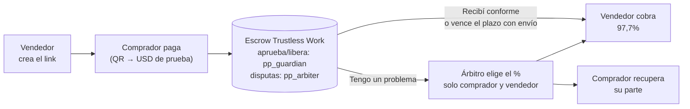

# Pago Protegido

**Links de pago protegidos para vender por redes sociales en Bolivia, sobre Stellar.**

El vendedor comparte un link. El comprador paga y la plata queda guardada en un contrato (escrow de Trustless Work) que nadie puede tocar, ni siquiera nosotros. Se libera cuando el comprador confirma que recibió. Si hay un problema, un árbitro solo puede repartir entre comprador y vendedor: el contrato no permite mandar la plata a ningún otro lado.

> **Estado:** MVP funcionando en **Stellar testnet**. La moneda es LABUSD ("USD de prueba"), y la rampa de bolivianos está simulada; la pantalla lo dice.

## El problema

<!-- DATOS-PROBLEMA -->

## Cómo funciona



1. **El vendedor crea el link** en la web o por WhatsApp con el bot ("vendo zapatillas nike 40 a 450 bs entrega 3 días") y lo comparte.
2. **El comprador paga.** Escanea el QR, la rampa simulada le acredita USD de prueba y firma el pago en su navegador. La plataforma paga la comisión de red. Antes de pedir la firma, la app verifica on-chain que el contrato sea el de Trustless Work con nuestros roles y muestra el sello "Contrato verificado".
3. **El vendedor marca "enviado"** con el código de encomienda.
4. **El comprador toca "Recibí conforme".** En una sola transacción, `pp_guardian` aprueba y libera. El vendedor cobra al instante:

   | Quién | Parte |
   |---|---|
   | vendedor | 97,7% |
   | plataforma | 2% |
   | Trustless Work | 0,3% |

   Si el comprador no responde y el envío está marcado, la plata se libera sola al vencer el plazo.
5. **Si hay un problema,** el comprador o el vendedor abren un reclamo, y el árbitro elige un porcentaje (por ejemplo 70/30). `pp_arbiter` reparte solo entre los dos.

Más detalle, con diagramas de secuencia y la máquina de estados: [docs/ARQUITECTURA.md](docs/ARQUITECTURA.md).

## Qué está construido y funcionando

| Pieza | Evidencia |
|---|---|
| **Contratos Soroban** `pp_guardian` y `pp_arbiter`, desplegados en testnet | [`CAOX6JZV…W4OZU`](https://stellar.expert/explorer/testnet/contract/CAOX6JZV3CJZFDD22J2XI3NKY5G4NRFOYRV7IA724MSVREYVRALW4OZU) y [`CBCDVLEP…G2PWGU`](https://stellar.expert/explorer/testnet/contract/CBCDVLEPJ6PN7RDC3HFGML3IUT7SOQEYSGH3LE3SWXWZJO7Z2QG2PWGU). Transacciones y comisiones reales en [contracts/DEPLOYED.md](contracts/DEPLOYED.md). |
| **Tests de contratos** | 27 tests (`cargo test`) contra el **WASM real** de Trustless Work. Cubren los 9 invariantes de seguridad. |
| **Flujo real en testnet** | `contracts/scripts/flujo-testnet.sh`, 4 escenarios: caso feliz, disputa 70/30, liberación automática a los 60 s y 5 intentos de robo rechazados. Los hashes están en DEPLOYED.md. |
| **App web** (Next.js, mobile-first, en español) | Panel del vendedor, link del comprador, panel del árbitro y "Cómo funciona". e2e con Playwright **contra testnet**, en 3 escenarios: caso feliz, disputa con intento de desvío rechazado, y liberación automática. Las capturas están en `app/e2e/capturas/`. |
| **Bot de WhatsApp** | Crea links desde el chat y avisa en cada paso. Tiene 69 tests unitarios y 2 e2e del simulador, y está listo para WhatsApp Cloud API. |
| **Métricas on-chain** | `contracts/scripts/metricas.sh` las calcula solo con eventos públicos (`getEvents`). La última corrida dio **14 compras**, ≈ Bs 12 725, 8 liberadas sin problema y 6 disputas resueltas. Detalle en [docs/METRICAS.md](docs/METRICAS.md). |
| **Bug reportable en Trustless Work** | Reproducido en testnet, con el fix y el test validados: [docs/reporte-trustless-work.md](docs/reporte-trustless-work.md) (borrador). |

## Cómo usa Stellar

- **Soroban:** dos contratos propios en Rust (soroban-sdk 28).
  - `pp_guardian` es *approver* y *release_signer*: hace la confirmación atómica y la liberación automática por plazo.
  - `pp_arbiter` es *dispute_resolver*: un árbitro acotado, sin destinos elegibles.
  - Emiten eventos `pp_*` para la transparencia.
- **Trustless Work:** usamos su escrow single-release **sin modificarlo** (commit `f0b706e`). Cada compra es una instancia nueva, desplegada e inicializada de forma atómica con `tw_new_single_release_escrow`. Los dos contratos de arriba ocupan sus roles críticos.
- **Pollar:** login con Google o email y billetera embebida, sin frases secretas, con `@pollar/core` y `@pollar/react`. La alternativa es una llave generada en el navegador. La llave del usuario nunca sale de su dispositivo.
- **Fee bump:** el usuario firma y la plataforma envuelve la transacción en un *fee bump* y paga la comisión de red. Nadie necesita XLM. La plataforma solo patrocina transacciones que ella misma armó.
- **USDC / LABUSD:** en testnet usamos LABUSD, un activo propio con su Stellar Asset Contract (7 decimales). En mainnet sería USDC. La rampa Bs → USD es simulada; en producción la haría una entidad certificada por ASFI.
- **Transparencia:** cada paso muestra "Ver en Stellar" (stellar.expert), y las métricas salen del RPC (`getEvents`).

## Seguridad en 5 líneas

1. Los roles que mueven la plata (aprobar, liberar y resolver) son contratos sin llave privada: nadie puede firmar por ellos.
2. El árbitro solo elige un porcentaje, y el destino sale del comprador registrado y del vendedor. No existe ninguna función que acepte otra dirección.
3. Confirmar es aprobar y liberar en la misma transacción, así que no queda ventana para disputar después.
4. Hay 27 tests de invariantes con el WASM real, y 5 ataques reales en testnet fueron rechazados sin que el atacante recibiera nada.
5. Antes de mainnet faltan una auditoría, un multisig para el admin del árbitro y la gestión de TTL. → [docs/SEGURIDAD.md](docs/SEGURIDAD.md)

## Cómo correrlo (3 comandos)

Requisitos:
- Node 22 o superior.
- [Stellar CLI](https://developers.stellar.org/docs/tools/cli) con las identidades de testnet `plataforma`, `arbitro`, `lab` y `twfee`.

```bash
cd pago-protegido/app
npm install
npm run setup          # crea .env.local con las llaves de TESTNET
npm run dev            # http://localhost:3000  (o PORT=3020 npm run dev)
```

Además:

| Qué | Comandos |
|---|---|
| Contratos | `cd pago-protegido/contracts && cargo test` |
| Bot, simulador sin red | `cd pago-protegido/bot && npm install && npm run sim:demo` (abre http://localhost:3030) |
| e2e contra testnet | `cd pago-protegido/app && npm run test:e2e` |
| Producción | [deploy/DEPLOY.md](deploy/DEPLOY.md): Docker + Caddy en un VPS, o Railway |
| Demo en vivo | [docs/DEMO.md](docs/DEMO.md) |

## Estructura del repositorio

```
pago-protegido/
├── app/          App web Next.js: vendedor, comprador, árbitro, API, SQLite, Pollar, fee bump
├── bot/          Bot de WhatsApp: links desde el chat y avisos del pedido (simulador + Cloud API)
├── contracts/    Contratos Soroban pp_guardian y pp_arbiter, tests, scripts de testnet, bindings TS
│   ├── DEPLOYED.md       IDs, hashes, transacciones y comisiones reales
│   └── DECISIONES.md     decisiones y hallazgos
├── deploy/       Dockerfiles, docker-compose + Caddy, Railway, túnel para la demo
└── docs/
    ├── ARQUITECTURA.md   diagramas y "quién puede hacer qué"
    ├── SEGURIDAD.md      modelo de amenazas, invariantes y ataques
    ├── METRICAS.md       métricas on-chain y página /transparencia
    ├── DEMO.md           guion de la demo de 3 minutos
    └── reporte-trustless-work.md   bug H-1 (borrador)
```

La especificación del MVP está en `docs-pp/SPEC.md`, en la raíz de `stellar-lab`.

## Plan de 30 días

<!-- PLAN-30-DIAS -->

## Equipo

<!-- EQUIPO -->
