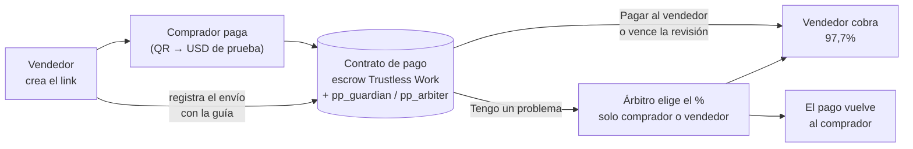

# Pago Protegido

**Pago contra confirmación de entrega para ventas por redes sociales en Bolivia, sobre Stellar.**

El vendedor comparte un link. El comprador paga y la plata queda en un contrato (un escrow de Trustless Work) hasta que confirma que recibió. Si hay un problema, un árbitro decide el reparto, pero **el pago solo puede ir al vendedor o volver al comprador**: el contrato no permite ningún otro destino, ni siquiera hacia nosotros.

> **Estado:** MVP funcionando en **Stellar testnet**. La moneda es LABUSD ("USD de prueba") y la rampa de bolivianos es simulada; la pantalla lo dice. Ver [Qué es real y qué es simulado](#qué-es-real-y-qué-es-simulado).

## El problema

- **Los bolivianos ya pagan con QR, y cada vez más.** En 2025, los pagos con QR sumaron **USD 51.293 millones**, más del doble que los USD 22.547 millones de 2024 ([Los Tiempos, 04/05/2026](https://www.lostiempos.com/actualidad/economia/20260504/2025-se-duplico-uso-del-qr-paso-us-22547-millones-51293-millones)).
- **Pagar por adelantado a un desconocido es el punto donde empieza la estafa.** En Tarija, **74 de las 91 denuncias por estafa** de 2026 empezaron en redes sociales, y la FELCC recomienda *"no hacer depósitos anticipados"* ([eju.tv, junio de 2026](https://eju.tv/2026/06/aumentan-las-estafas-en-redes-la-felcc-ya-atendio-91-denuncias/)).
- **Entre ciudades no hay contra entrega para vendedores chicos.** Si el producto viaja por encomienda, alguien tiene que confiar primero: o el comprador paga antes, o el vendedor despacha sin cobrar. Muchas ventas se pierden ahí.
- **Segmento inicial:** vendedores de **celulares y electrónica de Bs 1.000 a 7.000** que envían por encomienda a otras ciudades. Es donde el monto duele y la desconfianza frena la venta.

## Cómo funciona



1. **El vendedor crea el link** en la web o por WhatsApp con el bot ("vendo celular a 3500 bs entrega 3 días") y lo comparte.
2. **El comprador paga.**
   - Escanea el QR; la rampa simulada le acredita USD de prueba y firma el pago.
   - Al fondear acepta dos plazos: el del despacho y el de revisión después del envío.
   - Antes de pedir la firma, la app verifica on-chain que el contrato es el de Trustless Work con nuestros roles ("Contrato verificado").
3. **El vendedor registra el envío** con el código de encomienda (`mark_shipped`). Lo hace una sola vez, dentro del plazo, y la evidencia queda fija.
4. **El comprador toca "Pagar al vendedor"** y responde la pregunta obligatoria ("¿Tienes el producto en tus manos y lo revisaste?"). En una sola transacción, `pp_guardian` aprueba y libera:

   | Quién | Parte |
   |---|---|
   | vendedor | 97,7% |
   | plataforma | 2% |
   | Trustless Work | 0,3% |

   Si el comprador necesita más tiempo, puede extender la revisión una vez. Si no responde, el pago se libera solo al terminar la ventana de revisión.
5. **Si hay un problema**, el comprador o el vendedor abren un reclamo y el árbitro elige un porcentaje: `pp_arbiter` reparte solo entre ellos dos. Si el vendedor nunca despachó, el pago vuelve al comprador sin intervención del árbitro.

Diagramas de secuencia, máquina de estados y "quién puede hacer qué": [docs/ARQUITECTURA.md](docs/ARQUITECTURA.md).

## Qué es real y qué es simulado

| | Real (funciona hoy en Stellar testnet) | Simulado |
|---|---|---|
| **Contratos y escrow** | ✅ `pp_guardian` y `pp_arbiter` (Soroban) y el escrow de Trustless Work, con transacciones verificables en stellar.expert | — |
| **Firmas** | ✅ Cada paso lo firma quien corresponde (comprador, vendedor o árbitro), con autorización de Soroban | — |
| **Comisión de red** | ✅ La plataforma la paga con *fee bump*; nadie necesita XLM | — |
| **Bot de WhatsApp** | ✅ Lógica completa: crear links, avisos y recordatorios | El **número de WhatsApp** (simulador y número de prueba de Meta) |
| **Dinero** | — | **USD de prueba** (LABUSD, un activo de testnet) en lugar de USDC |
| **Rampa en bolivianos** | — | El pago con QR del banco y la acreditación de USD de prueba. En producción la haría una ETF (Empresa de Tecnología Financiera) autorizada por ASFI. |
| **Identidad** | — | **KYC**: no se hace en testnet |
| **Llaves** | En testnet, **Pollar guarda las llaves** de la billetera embebida (login con Google o email). La alternativa es una llave generada en el navegador. | — |

## Qué está construido y funcionando

| Pieza | Evidencia |
|---|---|
| **Contratos v2** (Soroban), desplegados en testnet | `pp_guardian` [`CDKYF7OA…UOATOT`](https://stellar.expert/explorer/testnet/contract/CDKYF7OAJTACP4JNJSGGXDRA3DHE442R26CT5ZE5DJHNSHH7XJUOATOT) y `pp_arbiter` [`CDTEA424…TEVU5UA`](https://stellar.expert/explorer/testnet/contract/CDTEA424AWSIIHEQ4FIQHFQOTWS3XAVLQHX7FI3MU6JZP4OPMTEVU5UA). Incorporan los hallazgos del red team sobre Trustless Work (TW-1, TW-2, TW-3, TW-5). IDs, hashes, transacciones y comisiones reales en [contracts/DEPLOYED.md](contracts/DEPLOYED.md). |
| **Tests de contratos** | **38 tests** (`cargo test`) contra el **WASM real** de Trustless Work: los 9 invariantes de seguridad y el red team. Los contratos **no son actualizables**. |
| **Flujo v2 real en testnet** | `contracts/scripts/flujo-v2-testnet.sh`, 6 escenarios, terminó con código 0:<br>• caso feliz;<br>• disputa 70/30;<br>• liberación automática 60 s después del envío;<br>• extensión de la revisión, verificada con la hora del ledger;<br>• devolución por falta de envío;<br>• **9 desvíos rechazados**: nadie, ni el admin del árbitro ni la plataforma, pudo mandar el pago a un tercero. |
| **App web** (Next.js, mobile-first, en español) | Panel del vendedor, link del comprador, panel del revisor y "Cómo funciona". **Usa los contratos v2**: los dos plazos en `fund`, `mark_shipped`, "Necesito más tiempo" (`extend`), la devolución automática si no se despacha (`refund_unshipped`) y `auto_release`, que respeta la disputa. El e2e con Playwright contra testnet cubre el flujo v2 (incluidos `extend` y la devolución), con capturas en `app/e2e/capturas/`. Video y capturas clave de la demo v2: [demo/v2/](demo/v2/). |
| **Bot de WhatsApp** | Crea links desde el chat (con código PP-#### y quién paga la protección), verifica links, avisa en cada paso y recuerda desde el envío con la hora que da la app. Tiene 174 tests unitarios y 4 e2e del simulador. |
| **Métricas en vivo y perfil de la tienda** | `/metricas` muestra los números con eventos on-chain (cada número enlaza a sus compras en stellar.expert) y `/tienda/<slug>` es el perfil verificable del vendedor, con insignia para la bio. El bot responde "mi perfil" con el link. e2e de solo lectura contra testnet: `npm run test:e2e:publico`. |
| **Métricas on-chain** | `contracts/scripts/metricas.sh` las calcula solo con eventos públicos (`getEvents`). Hasta ahora suma **47 compras** en v1 y v2, por ≈ USD 2.227 de prueba (≈ Bs 26.052), con liberaciones, extensiones, disputas y devoluciones. Detalle en [docs/METRICAS.md](docs/METRICAS.md). |
| **Bug reportable en Trustless Work (H-1)** | Reproducido en testnet, con el fix y el test validados: [docs/reporte-trustless-work.md](docs/reporte-trustless-work.md) (borrador). |
| **v1** (retirado para compras nuevas) | Contratos v1 con 27 tests y un flujo con 5 ataques rechazados: [contracts/DEPLOYED-v1.md](contracts/DEPLOYED-v1.md). |

## Cómo usa Stellar

- **Soroban:** dos contratos propios en Rust (soroban-sdk 28).
  - `pp_guardian` es *approver* y *release_signer*: hace la confirmación atómica, registra el envío una sola vez, lleva los plazos firmados por el comprador y libera automáticamente.
  - `pp_arbiter` es *dispute_resolver*: un árbitro acotado, sin destinos elegibles.
  - Emiten eventos `pp_*` para la transparencia.
- **Trustless Work:** usamos su escrow single-release **sin modificarlo** (commit `f0b706e`), una instancia por compra. Los dos contratos de arriba ocupan sus roles críticos.
- **Pollar:** login con Google o email y billetera embebida, sin frases secretas (`@pollar/core`, `@pollar/react`).
- **Fee bump:** el usuario firma y la plataforma envuelve la transacción en un *fee bump* y paga la comisión de red. La plataforma solo patrocina transacciones que ella misma armó.
- **USDC / LABUSD:** en testnet usamos LABUSD, un activo con su Stellar Asset Contract (7 decimales). En mainnet sería USDC.
- **Transparencia:** cada paso muestra "Ver en Stellar" (stellar.expert), y las métricas salen del RPC (`getEvents`).

## Seguridad en 5 líneas

1. Los roles que mueven el pago (aprobar, liberar y resolver) son contratos sin llave privada: nadie puede firmar por ellos.
2. El árbitro solo elige un porcentaje. El pago solo puede ir al vendedor o volver al comprador; no existe ninguna función que acepte otra dirección.
3. Confirmar es aprobar y liberar en la misma transacción. El envío se registra una sola vez y los plazos los firma el comprador.
4. Hay 38 tests de invariantes y del red team con el WASM real, y en testnet se rechazaron 9 desvíos reales sin que el tercero recibiera nada.
5. Antes de mainnet faltan una revisión externa, un multisig para el admin del árbitro y la gestión de TTL. → [docs/SEGURIDAD.md](docs/SEGURIDAD.md)

## Cómo correrlo (3 comandos)

Requisitos:
- Node 22 o superior.
- [Stellar CLI](https://developers.stellar.org/docs/tools/cli) con las identidades de testnet `plataforma`, `arbitro`, `lab` y `twfee`.

```bash
cd app
npm install
npm run setup          # crea .env.local con las llaves de TESTNET
npm run dev            # http://localhost:3000  (o PORT=3020 npm run dev)
```

Además:

| Qué | Comandos |
|---|---|
| Contratos | `cd contracts && cargo test` (38 tests) |
| Flujo v2 en testnet | `cd contracts && bash scripts/flujo-v2-testnet.sh` |
| Bot, tests | `cd bot && npm install && npm test` (174 unitarios + 4 e2e del simulador) |
| Bot, simulador sin red | `cd bot && npm run sim:demo` (abre http://localhost:3030) |
| Build de la app | `cd app && npm run build` |
| e2e público de la app (solo lectura, sin claves) | `cd app && npm run test:e2e:publico` |
| e2e de la app con pagos en testnet (necesita `.env.local`) | `cd app && npm run test:e2e` |
| Producción | [deploy/DEPLOY.md](deploy/DEPLOY.md): Docker + Caddy en un VPS, o Railway |
| Demo en vivo | [docs/DEMO.md](docs/DEMO.md) |

## Estructura del repositorio

```
pago-protegido/
├── app/          App web Next.js: vendedor, comprador, árbitro, API, SQLite, Pollar, fee bump
├── bot/          Bot de WhatsApp: links desde el chat y avisos del pedido (simulador + Cloud API)
├── contracts/    Contratos Soroban v2 (pp_guardian, pp_arbiter), 38 tests, scripts de testnet, bindings TS
│   ├── wasm/             escrow de Trustless Work (commit f0b706e) que usan los tests
│   ├── DEPLOYED.md       v2: IDs, hashes, transacciones y comisiones reales (v1: DEPLOYED-v1.md)
│   └── DECISIONES.md     decisiones, interfaz v2 y hallazgos
├── deploy/       Dockerfiles, docker-compose + Caddy, Railway, túnel para la demo
├── docs/
│   ├── SPEC.md           especificación original del MVP v1
│   ├── ARQUITECTURA.md   diagramas y "quién puede hacer qué"
│   ├── SEGURIDAD.md      modelo de amenazas, invariantes, red team TW-1..TW-5
│   ├── METRICAS.md       métricas on-chain y página /transparencia
│   ├── DEMO.md           guion de la demo de 3 minutos
│   ├── USUARIOS.md       registro de entrevistas (y de pilotos, desde el plan de 30 días)
│   └── reporte-trustless-work.md   bug H-1 (borrador)
├── CHANGELOG.md  qué se hizo en cada etapa y pendientes de la entrega
└── DECISIONES.md decisiones al crear este repo (las de cada pieza están en app/, bot/ y contracts/)
```

La especificación original del MVP está en [docs/SPEC.md](docs/SPEC.md). Las decisiones de cada pieza están en [app/DECISIONES.md](app/DECISIONES.md), [bot/DECISIONES.md](bot/DECISIONES.md) y [contracts/DECISIONES.md](contracts/DECISIONES.md).

## Validación de esta semana

Esta semana validamos **con entrevistas y con un formulario**, no con pilotos:

- **Entrevistas** a vendedores del segmento inicial, con nota de consentimiento y registro en [docs/USUARIOS.md](docs/USUARIOS.md).
- **Formulario de lista de espera** en `/piloto`. `npm run piloto:csv` exporta las inscripciones (el CSV no se versiona).

Los **20 pilotos** arrancan en el plan de 30 días.

## Plan de 30 días


| Semana | Fechas | Objetivo |
|---|---|---|
| 1 | 30 nov – 6 dic | Arrancar los **20 pilotos** con vendedores del segmento inicial (elegidos entre las entrevistas y el formulario) y conseguir un socio ETF para la rampa en bolivianos |
| 2 | 7 – 13 dic | Piloto con pedidos reales sobre testnet: vendedores y compradores reales, montos de prueba |
| 3 | 14 – 20 dic | Prueba A/B de precio (quién paga la comisión y cuánto) y bot con número de WhatsApp real |
| 4 | 21 – 27 dic | Mainnet acotado, con topes por pedido y por vendedor, **solo con una opinión legal favorable** |

**Entregables a 30 días:**
1. Contratos en mainnet con revisión externa, y el reporte del bug H-1 enviado a Trustless Work.
2. Rampa en bolivianos con una ETF, en su sandbox.
3. Bot con número real, verificador e insignia.
4. 20 pilotos con vendedores del segmento inicial, medidos en [docs/USUARIOS.md](docs/USUARIOS.md) y en las métricas on-chain.

## Equipo


| Persona | Rol |
|---|---|
| **Hans** | Tecnología |
| **Joaquín** | Usuarios y ventas |
