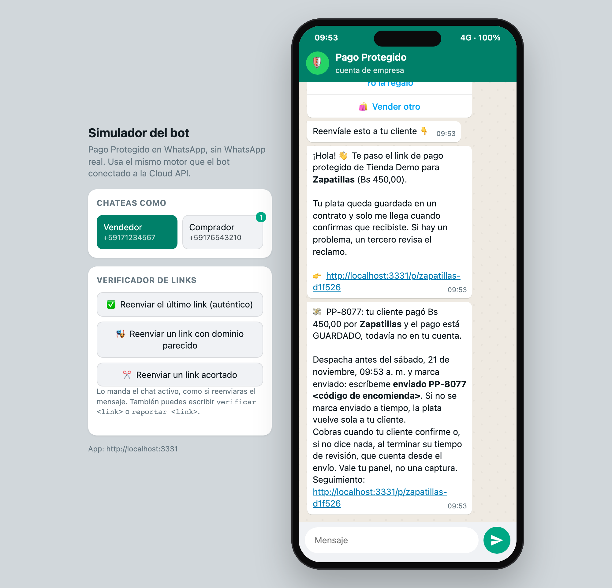
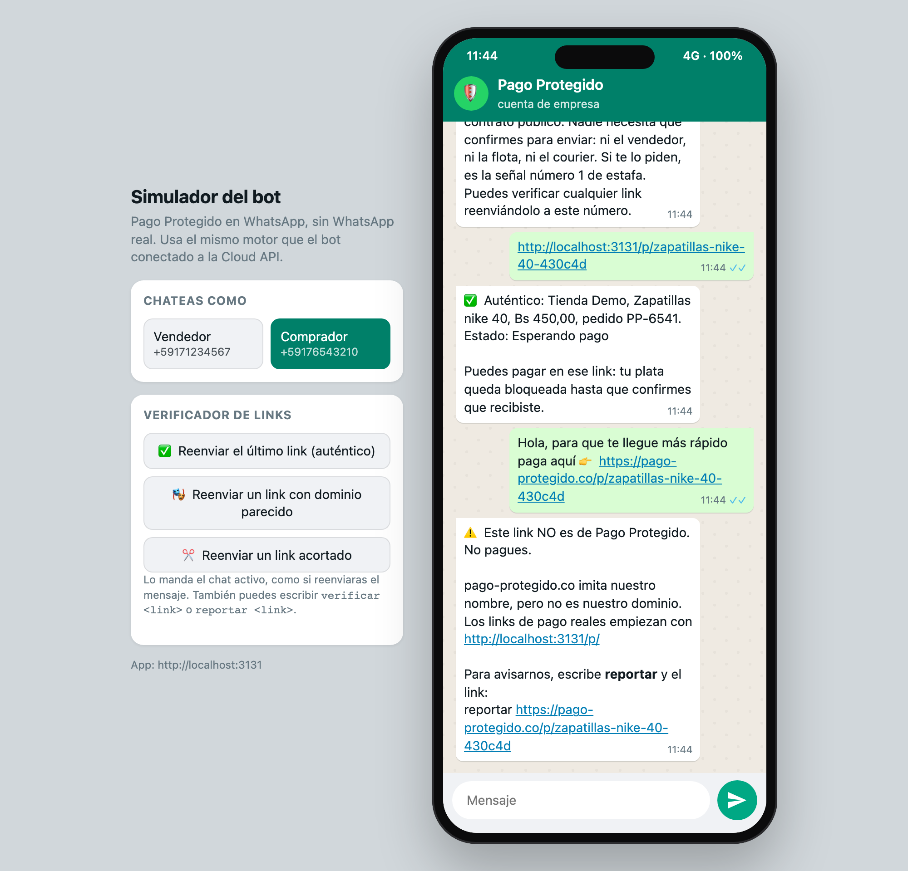

# Trato: bot de WhatsApp

Con este bot, el vendedor crea links de pago desde el chat y recibe un aviso en cada paso del pedido. Habla con la app web ([`../app`](../app)) por su API y **nunca tiene llaves de billeteras**.

```
Vendedor: vendo celular Samsung A54 a 1800 bs entrega 3 días
Bot:      ¡Listo! ✅ Tu link de pago protegido:
          *Celular Samsung A54* · Bs 1.800,00 · entrega en 3 días
          👉 https://…/p/celular-samsung-a54-a1b2c3
          🛡️ Protección: la paga tu cliente (Bs 27,00). Paga Bs 1.827,00 (≈ 156,15 USD de prueba) y tú recibes Bs 1.800,00.
          Código: *PP-4821*. …                    [La paga mi cliente] [Yo la regalo] [Vender otro]
…
Bot:      💸 PP-4821: tu cliente pagó Bs 1.800,00 por *Celular Samsung A54* y el pago está GUARDADO, todavía no en tu cuenta.
          Despacha antes del sábado, 21 de noviembre, 11:00 y marca enviado: escríbeme *enviado PP-4821 <código de encomienda>*.
          Si no se marca enviado a tiempo, la plata vuelve sola a tu cliente.
Comprador: https://pago-protegido.co/p/celular-samsung-a54-a1b2c3
Bot:      ⚠️ Este link NO es de Trato. No pagues.
```



- **Qué entiende:** hola/ayuda, vender en texto libre (con preguntas si falta el producto, el precio o los días), mis ventas, `estado <código>`, `enviado <código> <guía>`, saldo, cancelar y quién paga la protección ([La paga mi cliente] / [Yo la regalo]). El código es el "PP-4821" que genera la app ("pp 4821" o "4821" también sirven).
- **Contratos v2 (app v2):** el link se crea con la protección a cargo del cliente y, si el producto es un celular, con la categoría "Celular" (la app pide el IMEI al despachar). Al pagar, el bot dice hasta cuándo se puede despachar; si no se marca enviado a tiempo, la app devuelve la plata sola y el bot avisa a los dos (`devuelto`). La hora de liberación cuenta desde el envío y "Necesito más tiempo" (una vez, en la web) la corre: el bot avisa al vendedor y reprograma los recordatorios. Ver DECISIONES 41–46.
- **Números sin tienda:** les manda el link de registro a la web. Igual pueden verificar y reportar links.
- **Avisos:** al vendedor, cuando le pagan (el pago queda GUARDADO, todavía no en su cuenta), cuando se libera la plata y cuando abren un reclamo. Al comprador (si tenemos su número), el aviso anti-presión al pagar, "¿te llegó?" al enviar, el reclamo y recordatorios 48 h, 24 h y 2 h antes de la liberación automática.

### Anti-fraude



- **Verificador de links:** cualquiera le reenvía un link (o escribe `verificar <link>`).
  - Si el dominio es **exactamente** el de la app (`PP_APP_URL` o `PP_PUBLIC_URL`), la ruta es `/p/<slug>` y el pedido existe: `✅ Auténtico: <tienda>, <producto>, Bs <precio>, pedido <código>. Estado: <estado>`.
  - En cualquier otro caso: `⚠️ Este link NO es de Trato. No pagues.`, más el motivo: dominio parecido (`pago-protegido.co`, `pagoprotegid0`, letras cirílicas, `pagoprotegido.bo.otro.com`…), acortador (`bit.ly`, `tinyurl`, `cutt.ly`, `acortar.link`…), `usuario@` escondido, slug inválido o pedido que no existe.
- **`reportar <link>`:** guarda el reporte en `data/reportes.jsonl` (una línea JSON por reporte) y agradece.
- **Anti-presión al comprador** (si dejó su WhatsApp), al pagar y otra vez al enviar: "Tu plata está bloqueada en un contrato público. Nadie necesita que confirmes para enviar: ni el vendedor, ni la flota, ni el courier. Si te lo piden, es la señal número 1 de estafa. Puedes verificar cualquier link reenviándolo a este número."
- **Recordatorios del plazo** a las 48 h, 24 h y 2 h de la liberación automática, que cuenta desde que el pedido se marca enviado (hora que da la app, `release_at` del contrato v2). Ofrecen "Tengo un problema" y "Necesito más tiempo" (más "Sí, todo bien"), con el link a la página del pedido. Con `DEMO_MINUTES=1` las horas se cuentan en minutos.
- **Al vendedor:** al registrarse, "Para cobrar no tienes que abrir ningún link: el pago te llega solo. Un mensaje que diga 'entra aquí para cobrar' es falso."; con cada link de pago, "Ojo: el QR de pago nunca está a nombre de una persona."
- **Palabras prohibidas:** un test revisa que ningún mensaje diga cripto, token, stablecoin, wallet, llave, blockchain, garantía, seguro ni custodia, ni "¡Te pagaron!".
- **Marcar enviado** es una firma on-chain del vendedor. Por eso el bot solo le manda el link de la página donde la confirma con su billetera.
- **Decisiones** tomadas fuera del SPEC: [`DECISIONES.md`](DECISIONES.md). **Endpoints** que faltan en la app (con planes B que ya funcionan): [`APP-ENDPOINTS.md`](APP-ENDPOINTS.md).

## Correr el simulador

Necesitas Node 22 o superior.

```bash
cd pago-protegido/bot
npm install
npm run sim:demo        # simulador + app de mentira → http://localhost:3030
```

- Abre http://localhost:3030. Chateas como la "Tienda Demo" (+591 71234567). Prueba con `hola`, `vender zapatillas 450` o `vendo zapatillas nike 40 a 450 bs entrega 3 días`.
- Los botones de la izquierda simulan lo que pasa en la web: "El cliente pagó", "El vendedor firmó el envío", "Adelantar al próximo recordatorio" (48 → 24 → 2 h), "El cliente pidió más tiempo", "No se despachó a tiempo (devolución)", "El cliente confirmó", "Abrió un reclamo" y "El revisor resolvió 70/30". El bot detecta cada cambio y avisa.
- Cambia a **Comprador** para ver el aviso anti-presión, "¿te llegó?" y los recordatorios. El globito verde cuenta los mensajes sin leer.
- **Verificador de links:** reenvía desde el chat activo el último link auténtico, uno con dominio parecido o uno acortado. También puedes escribir `verificar <link>` o `reportar <link>`.
- **Demo en minutos:** `DEMO_MINUTES=1 npm run sim:demo`. Los recordatorios llegan 48, 24 y 2 minutos antes del plazo. En la app de mentira el despacho tiene días × 24 minutos y la revisión, (días + 3) × 24 minutos desde el envío.

### Contra la app real (testnet)

```bash
# en otra terminal: cd ../app && npm run dev       (http://localhost:3000)
PP_APP_URL=http://localhost:3000 SIM_SELLER_PHONE=59171234567 npm run sim
```

1. Crea tu tienda en http://localhost:3000/vender con el mismo WhatsApp que `SIM_SELLER_PHONE`.
2. Mientras la app no tenga `GET /api/bot/sellers` (APP-ENDPOINTS.md §1), vincula el número en el simulador con `vincular G…tu clave pública…`. La clave completa está en `/panel`: toca el link "Billetera" y cópiala de la dirección de stellar.expert.
3. Crea un link desde el chat, págalo en la web y el aviso llega al chat (cada 10 s, `POLL_INTERVAL_MS`).

## Tests

```bash
npx playwright install chromium   # solo la primera vez (la app usa la misma versión)
npm test                          # unitarios (Vitest) + e2e del simulador (Playwright)
```

- **Unitarios (241):**
  - Precios y frases bolivianas: "450bs", "Bs. 450", "Bs 1.200", "450 pesos", "Bs 250.-", "5 mil", tallas que no son precios, dólares.
  - Intenciones y flujos guiados.
  - Mensajes: nunca dicen "cripto" y respetan los límites de WhatsApp.
  - El bot contra la app de mentira por HTTP, con sus planes B.
  - El poller, con los avisos y el recordatorio.
  - El webhook de WhatsApp: verificación, firma, botones y reintentos.
  - **El flujo real** (`test/whatsapp-real.test.ts`): el bot en su propio proceso, en modo WhatsApp, contra una API de Meta simulada por HTTP, en testnet y en mainnet, con y sin plantilla.
  - La ventana de 24 horas, los errores de Meta y el estado guardado (`test/outbox.test.ts`).
  - Verificador (`test/links.test.ts`): dominios parecidos (guion, cero por o, l por i, tildes, cirílico, punycode, subdominios engañosos, punto final), acortadores, `usuario@`, slugs y rutas inválidos, links dentro de un mensaje reenviado.
  - Anti-fraude contra la app de mentira (`test/antifraude.test.ts`): auténtico/falso, pedido inexistente, app caída, reportes en archivo, botones del recordatorio, avisos al vendedor, anti-presión (también si el comprador deja su WhatsApp tarde), recordatorios 48/24/2 h, hitos antes del envío y modo demo en minutos.
  - Palabras prohibidas en todos los mensajes.
- **e2e (4):**
  - Levanta la app de mentira (3131) y el simulador (3130) como procesos aparte.
  - Escribe "vender zapatillas 450", toca "3 días", recibe el link y verifica que el pedido existe en la API.
  - Simula el pago y espera "¡Te pagaron!".
  - Guarda la captura en `docs/simulador.png`.
  - Verificador: el comprador reenvía el link auténtico y uno con dominio parecido, luego uno acortado y un reporte. Guarda la captura en `docs/verificador.png`.
  - El comprador recibe el aviso anti-presión al pagar.
- `npm run typecheck` revisa los tipos.

## WhatsApp real (número de prueba de Meta)

Paso a paso en [`../docs/WHATSAPP.md`](../docs/WHATSAPP.md): la app en Meta, el número de prueba y sus 5 teléfonos, los tokens, el webhook, el servicio en Railway, la ventana de 24 horas y una prueba de humo de 2 minutos.

`npm start` (o la imagen de `deploy/bot.Dockerfile`) arranca en modo WhatsApp. Si falta una variable, si la app no acepta la clave del bot o si corre en otra red que `STELLAR_NETWORK`, no arranca y dice qué pasó. Para probar desde tu computadora, expón el puerto 3040 con un túnel (`cloudflared tunnel --url http://localhost:3040`) y usa en `PP_PUBLIC_URL` la URL `https` de la app.

## Variables de entorno

Se leen de `.env` si existe (ver [`.env.example`](.env.example)). **Nunca commitees tokens.**

| Variable | Por defecto | Para qué |
|---|---|---|
| `PP_APP_URL` | `http://localhost:3000` | API de la app web |
| `PP_PUBLIC_URL` | `PP_APP_URL` | URL de los links que ve la gente (túnel o dominio) |
| `PP_BOT_KEY` | vacío | Clave compartida con la app para `/api/bot/*` (APP-ENDPOINTS.md §0) |
| `STELLAR_NETWORK` | `testnet` | Red de la app de `PP_APP_URL`: `testnet` o `mainnet`. Cambia la moneda de los mensajes y se comprueba al arrancar |
| `WA_TOKEN` | — | Token de la Graph API (`npm start`) |
| `WA_PHONE_NUMBER_ID` | — | ID del número que envía (`npm start`) |
| `WA_VERIFY_TOKEN` | — | Palabra para verificar el webhook (`npm start`) |
| `WA_APP_SECRET` | — | Clave secreta de la app de Meta: se exige la firma `X-Hub-Signature-256` (`npm start`) |
| `WA_TEMPLATE_AVISO` / `WA_TEMPLATE_LANG` | vacío / `es` | Plantilla aprobada para avisar fuera de las 24 horas. Vacía = los avisos esperan a que la persona escriba |
| `WA_GRAPH_VERSION` | `v23.0` | Versión de la Graph API |
| `PORT` | `3040` | Puerto del webhook |
| `SIM_PORT` | `3030` | Puerto del simulador |
| `MOCK_PORT` | `3031` | Puerto de la app de mentira (`sim:demo`, `npm run mock`) |
| `POLL_INTERVAL_MS` | `10000` | Cada cuánto se buscan cambios en los pedidos |
| `REMINDER_HOURS` | `48,24,2` | Horas antes de la liberación automática en que se recuerda al comprador |
| `DEMO_MINUTES` | vacío | `1` = modo demo: las horas de los recordatorios (y los plazos de la app de mentira) se cuentan en minutos |
| `REPORTS_FILE` | `data/reportes.jsonl` | Dónde se guardan los `reportar <link>`; `""` = solo en memoria |
| `BOT_STATE_FILE` | `data/bot-state.json` | Avisos y recordatorios ya enviados, avisos que esperan, ventanas de 24 horas, números vinculados y tiendas ya avisadas; `""` = solo en memoria |
| `SIM_SELLER_PHONE` / `SIM_BUYER_PHONE` | `59171234567` / `59176543210` | Números de los dos chats del simulador |

## Arquitectura

```
src/
  engine/              motor de conversación, funciones puras
    parse.ts           precios en Bs, días, venta en texto libre, teléfonos y códigos
    engine.ts          intenciones y step(sesión, texto, ahora) → { sesión, respuestas, comando }
    messages.ts        todos los textos (es-BO) y avisos
    links.ts           verificador: dominio canónico exacto, dominios parecidos, acortadores, slugs
  app/                 cliente de la app (rutas reales + propuestas) y sus tipos
  bot.ts               runtime: vendedor por teléfono → step → ejecuta el comando → respuestas
  notify/poller.ts     avisos por cambio de estado, anti-presión y recordatorios 48/24/2 h
  notify/outbox.ts     ventana de 24 horas de WhatsApp: qué sale, qué espera y qué se reintenta
  state.ts             estado en un archivo, por instancia de la app
  reports.ts           reportes de links (JSONL local)
  transports/
    whatsapp.ts        webhook (GET verificación, POST mensajes, firma) + envío por Graph API
    simulator.ts       servidor del simulador (SSE) + sim.html (chat estilo WhatsApp)
  mock/app-mock.ts     app de mentira con las mismas formas de la API (tests, e2e, demo)
  main.ts              arranque: --sim, --mock, --whatsapp
```

- **Mismo motor en los dos transportes:** el simulador y el webhook llaman a `bot.handle(teléfono, texto)` y mandan lo que devuelve. Los avisos del poller salen por el transporte activo.
- **No custodia:** el bot solo usa `POST /api/links`, que no va on-chain, y lecturas. Para marcar enviado, manda el link y el vendedor firma en su billetera. El verificador solo lee `GET /api/orders/:slug`, la misma vista pública de la página del pedido.
- **Antes de buscar la tienda:** `bot.handle` pasa primero por `routePublic` (verificar, reportar, botones del comprador, links reenviados), así cualquier número puede usarlos.
