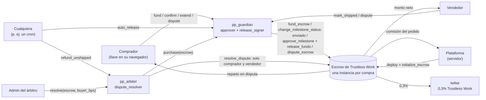
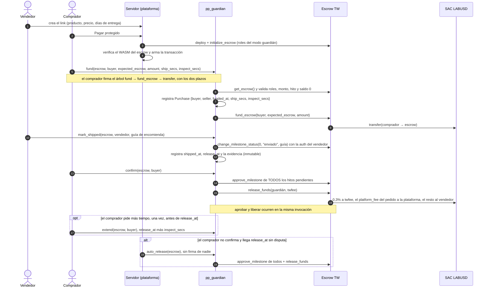
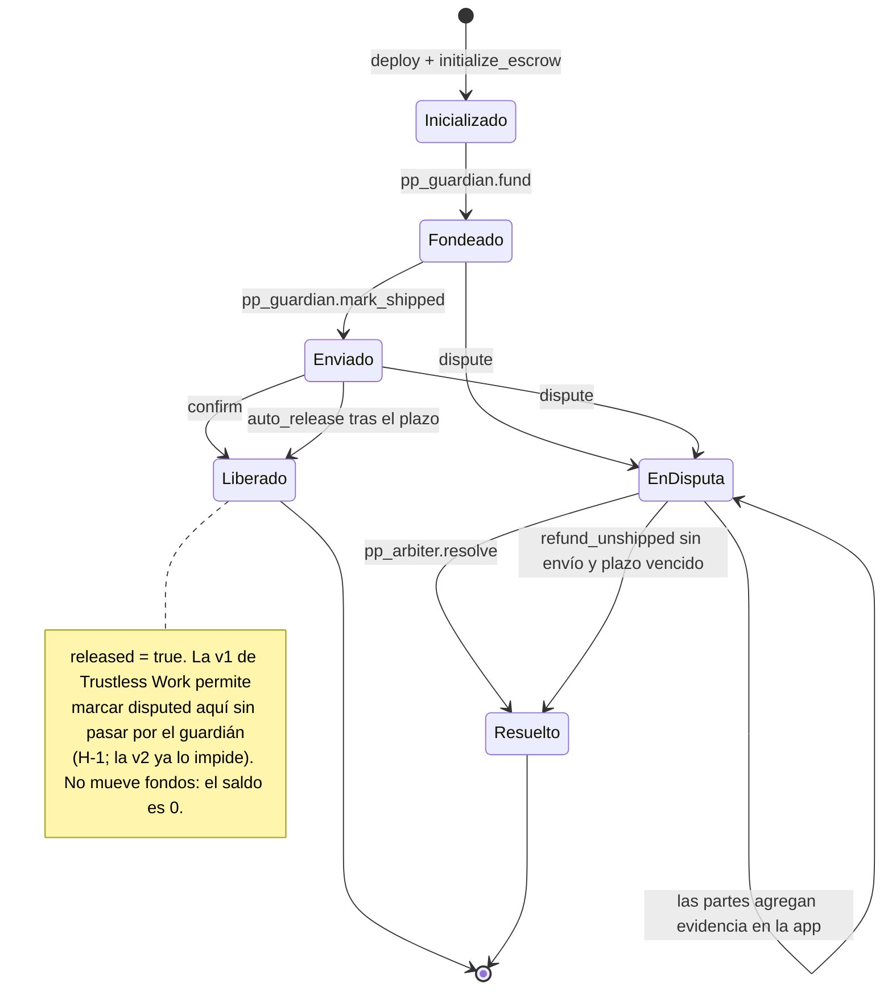

# Arquitectura de Trato (antes Pago Protegido): contratos en testnet

Trato usa el escrow single-release de **Trustless Work** (TW) sin modificarlo y le agrega dos contratos propios que ocupan sus roles críticos:

- **`pp_guardian`** ocupa los roles *approver* y *release_signer*: el comprador fondea a través de él, confirma con aprobación y liberación atómicas, y se libera solo automáticamente si vence el plazo.
- **`pp_arbiter`** ocupa el rol *dispute_resolver*: un árbitro acotado que solo puede repartir entre el comprador registrado y el vendedor.

> **v2 (ronda 4, red team), con contratos nuevos:**
> - el envío se registra con `pp_guardian.mark_shipped`, una vez y con evidencia inmutable;
> - el comprador firma dos plazos al fondear: despacho (`ship_secs`) y revisión (`inspect_secs`);
> - `confirm` y `auto_release` aprueban **todos** los hitos;
> - `extend` alarga la revisión una vez;
> - `refund_unshipped` usa el plazo de despacho.
>
> Detalle en [`contracts/DECISIONES.md`](../contracts/DECISIONES.md) §v2 y [SEGURIDAD.md](SEGURIDAD.md) §4b.

Cada compra es una instancia nueva del escrow de TW. Los IDs y transacciones reales están en [`contracts/DEPLOYED.md`](../contracts/DEPLOYED.md) y el código en [`contracts/`](../contracts/).

| Pieza | Testnet |
|---|---|
| pp_guardian v2 | [`CDKYF7OA…UOATOT`](https://stellar.expert/explorer/testnet/contract/CDKYF7OAJTACP4JNJSGGXDRA3DHE442R26CT5ZE5DJHNSHH7XJUOATOT) |
| pp_arbiter v2 | [`CDTEA424…TEVU5UA`](https://stellar.expert/explorer/testnet/contract/CDTEA424AWSIIHEQ4FIQHFQOTWS3XAVLQHX7FI3MU6JZP4OPMTEVU5UA) |
| Escrow TW v1 (WASM, commit `f0b706e`) | hash `1b367bc8…196660`, una instancia por compra |
| v1 (retirado para compras nuevas) | pp_guardian [`CAOX6JZV…W4OZU`](https://stellar.expert/explorer/testnet/contract/CAOX6JZV3CJZFDD22J2XI3NKY5G4NRFOYRV7IA724MSVREYVRALW4OZU) · pp_arbiter [`CBCDVLEP…G2PWGU`](https://stellar.expert/explorer/testnet/contract/CBCDVLEPJ6PN7RDC3HFGML3IUT7SOQEYSGH3LE3SWXWZJO7Z2QG2PWGU) |
| Moneda | LABUSD (USD de prueba, 7 decimales), SAC [`CC65P6TQ…OGBD4S`](https://stellar.expert/explorer/testnet/contract/CC65P6TQQ646YDXVS3PM6YVZASXW6WM5B67YKI46JH4EG65LJPOGBD4S) |

## 1. Roles y contratos



Configuración del escrow en modo guardián (SPEC §2):

| Rol de TW | Quién |
|---|---|
| approver | `pp_guardian` |
| release_signer | `pp_guardian` |
| dispute_resolver | `pp_arbiter` |
| service_provider | vendedor |
| receiver | vendedor |
| platform | cuenta de la plataforma |

Además: `platform_fee` es la comisión de la plataforma **que se define al crear el pedido** (200 bps si el vendedor regala la protección; si la paga el comprador, la app la calcula para que el vendedor reciba al menos el precio; ver [la tarifa del README](../README.md#tarifa)), hay un solo hito ("Entrega del producto", con status inicial `"pendiente"`) y el token es LABUSD.

Dos propiedades sostienen el diseño:

1. **Un contrato no tiene llave privada.** El escrow exige `approver.require_auth()`, `release_signer.require_auth()` y `dispute_resolver.require_auth()`. Como esos roles son contratos sin `__check_auth`, solo se cumplen cuando el propio contrato hace la llamada. Por eso nadie, ni siquiera sus admins, puede aprobar, liberar o resolver por fuera del código de `pp_guardian` y `pp_arbiter`.
2. **No hay destinos elegibles.**
   - El escrow siempre libera a `roles.receiver`, y la plataforma no puede cambiar ese rol cuando el escrow ya tiene fondos.
   - `pp_arbiter` arma el reparto solo con `Purchase.buyer`, que registró el guardián al fondear, y con `roles.receiver`.
   - La dirección de la comisión de TW (`tw_fee`) queda fija en el constructor de ambos contratos.

## 2. Secuencia: caso feliz



## 3. Secuencia: disputa

```mermaid
sequenceDiagram
  autonumber
  actor C as Comprador
  actor V as Vendedor
  actor A as Admin del árbitro
  participant G as pp_guardian
  participant R as pp_arbiter
  participant E as Escrow TW
  C->>G: dispute(escrow, comprador)
  Note over C,G: también puede abrirla el vendedor, nadie más
  G->>E: dispute_escrow(guardián)
  Note over E: disputed = true, confirm y auto_release quedan bloqueados
  V->>A: su versión y evidencia, en la app (fuera de la cadena)
  A->>R: quote(escrow, 7000), vista previa sin firma
  A->>R: resolve(escrow, 7000)
  R->>E: get_escrow() verifica disputa y dispute_resolver
  R->>G: purchase(escrow) devuelve el comprador registrado
  R->>R: vendedor = floor(saldo x 30%), comprador = saldo - vendedor
  R->>E: resolve_dispute(árbitro, twfee, reparto comprador y vendedor)
  E-->>C: 70% menos comisiones
  E-->>V: 30% menos comisiones
  alt el vendedor nunca marcó enviado y venció el plazo de despacho
    C->>R: refund_unshipped(escrow), sin firma (cualquiera; hoy la dispara la app), todo el saldo al comprador menos comisiones
  end
```

## 4. Máquina de estados del escrow (vista de Trato)



Correspondencia con los flags on-chain del escrow:

| Estado | Flags y status |
|---|---|
| Fondeado | `released`, `disputed` y `resolved` en `false`; status `"pendiente"`; saldo igual a `amount` |
| Enviado | lo mismo que Fondeado, con status `"enviado"` |
| EnDisputa | `disputed = true` |
| Liberado | `released = true` y el hito con `approved = true` |
| Resuelto | `resolved = true` y `disputed = false` |

## 5. Quién puede hacer qué

✅ = puede · ❌ = el contrato lo rechaza · — = no aplica

| Acción | Comprador | Vendedor | Plataforma | Admin del árbitro | Cualquiera / tercero |
|---|:-:|:-:|:-:|:-:|:-:|
| Desplegar e inicializar el escrow | — | — | ✅ ¹ | — | ✅ ¹ |
| `pp_guardian.fund` (fondear) | ✅ con su firma | ❌ `BuyerIsSeller` | ✅ ² | ✅ ² | ✅ ² |
| Registrar el envío (`pp_guardian.mark_shipped`, v2) | ❌ | ✅ una vez, antes del plazo de despacho | ❌ | ❌ | ❌ `NotSeller` |
| `pp_guardian.extend` (v2) | ✅ una vez, antes de `release_at` | ❌ | ❌ | ❌ | ❌ `NotBuyer` |
| `pp_guardian.confirm` (aprobar + liberar) | ✅ solo el registrado | ❌ `NotBuyer` | ❌ | ❌ | ❌ |
| Aprobar o liberar directo en el escrow | ❌ ³ | ❌ ³ | ❌ ³ | ❌ ³ | ❌ ³ |
| `pp_guardian.dispute` | ✅ | ✅ | ❌ `NotBuyerOrSeller` | ❌ | ❌ |
| `dispute_escrow` directo en el escrow | ❌ (no tiene rol en TW) | ✅ ⁴ | ✅ ⁴ | ❌ | ❌ |
| `pp_guardian.auto_release` | ✅ ⁵ | ✅ ⁵ | ✅ ⁵ | ✅ ⁵ | ✅ ⁵ |
| `pp_arbiter.resolve(buyer_bps)` | ❌ | ❌ | ❌ | ✅ solo en disputa | ❌ |
| `resolve_dispute` directo en el escrow | ❌ | ❌ | ❌ | ❌ ³ | ❌ ³ |
| `pp_arbiter.refund_unshipped` | ✅ ⁶ | ✅ ⁶ | ✅ ⁶ | ✅ ⁶ | ✅ ⁶ |
| Elegir a quién se paga | ❌ | ❌ | ❌ | ❌ (solo el porcentaje) | ❌ |
| Cambiar receiver o roles con fondos adentro (`update_escrow`) | ❌ | ❌ | ❌ `#33`, `#16` en disputa | ❌ | ❌ |
| Agregar hitos con fondos adentro (`update_escrow`) | ❌ | ❌ | ⚠️ sí ⁷ | ❌ | ❌ |
| `pp_guardian.set_arbiter` (una sola vez) | ❌ | ❌ | ❌ | ✅ (admin del guardián) | ❌ |
| `pp_arbiter.set_admin` | ❌ | ❌ | ❌ | ✅ | ❌ |

1. `initialize_escrow` de TW no exige firma. Si alguien se adelanta con otros roles, `fund` lo rechaza, así que solo es un DoS de esa instancia. Por eso la app usa `tw_new_single_release_escrow`, y como esa fábrica despliega el hash que reciba (TW-4), verifica el hash del WASM antes de pedir firmas.
2. Quien llama `fund` queda registrado como comprador y paga con su propio saldo.
3. Esos roles son los contratos `pp_guardian` y `pp_arbiter`. Nadie puede firmar por un contrato.
4. TW lo permite porque son roles del escrow. Solo congela los fondos, que se resuelven por `pp_arbiter`.
5. Solo funciona con el plazo vencido, sin disputa y con el hito en `"enviado"`. Paga al vendedor.
6. Solo funciona con disputa, plazo vencido y el hito **sin** `"enviado"`. Paga al comprador.
7. En v2, `confirm` y `auto_release` aprueban todos los hitos pendientes (TW-2). Si un hito agregado no se puede aprobar, queda la vía de disputa y revisor; los fondos no se pueden desviar.

## 6. Comisiones

TW calcula sobre el monto liberado o repartido: 0,3% para Trustless Work (fijo en su código) y el `platform_fee` del pedido para la plataforma. Las descuenta también en devoluciones y disputas: en una disputa, cada parte paga comisiones en proporción a lo que recibe. Quién paga la protección y cuánto: [README, Tarifa](../README.md#tarifa).

Ejemplo con `platform_fee` = 2% (el caso "Yo la regalo", 2,3% en total):

| Desenlace (compra de 150 LABUSD) | Comprador | Vendedor | Plataforma | TW |
|---|---:|---:|---:|---:|
| `confirm` o `auto_release` | — | 146,550 | 3,000 | 0,450 |
| `resolve` 70/30 | 102,585 | 43,965 | 3,000 | 0,450 |
| `refund_unshipped` (todo el saldo al comprador) | 146,550 | — | 3,000 | 0,450 |

## 7. Métricas on-chain

Los dos contratos emiten estos eventos `pp_*`:

| Contrato | Eventos |
|---|---|
| pp_guardian | `pp_funded`, `pp_shipped` (v2), `pp_extended` (v2), `pp_confirmed`, `pp_auto_released`, `pp_disputed`, `pp_arbiter_set` |
| pp_arbiter | `pp_resolved`, `pp_refunded_unshipped`, `pp_admin_changed` |

`contracts/scripts/metricas.sh` los lee con `getEvents` y produce las métricas públicas. Formato y uso desde la app: [METRICAS.md](METRICAS.md).
