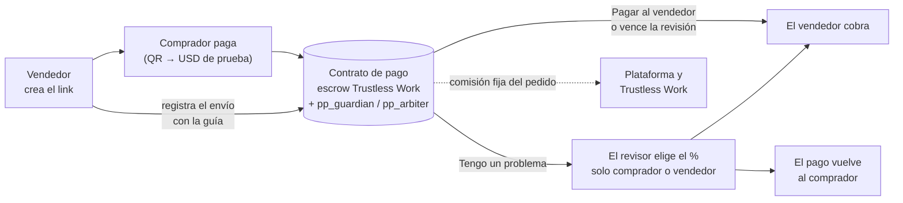

# Trato: detalle técnico

Este documento tiene el detalle técnico de Trato. El resumen para el jurado, el avance entre entregas, el plan de 30 días y el equipo están en el [README](../README.md); el problema, con sus fuentes, en [PROBLEMA.md](PROBLEMA.md).

> **Trato** antes se llamaba Pago Protegido. El repo, los paquetes, los contratos (`pp_guardian`, `pp_arbiter`), las variables `PP_*`, los códigos de pedido `PP-`, las rutas y los dominios conservan el nombre anterior.

| | |
|---|---|
| **Contratos v2 (Stellar testnet)** | `pp_guardian` [`CDKYF7OA…UOATOT`](https://stellar.expert/explorer/testnet/contract/CDKYF7OAJTACP4JNJSGGXDRA3DHE442R26CT5ZE5DJHNSHH7XJUOATOT) · `pp_arbiter` [`CDTEA424…TEVU5UA`](https://stellar.expert/explorer/testnet/contract/CDTEA424AWSIIHEQ4FIQHFQOTWS3XAVLQHX7FI3MU6JZP4OPMTEVU5UA) |
| **Escrow de Trustless Work** | una instancia por compra; ejemplo del caso feliz: [`CCS74JS3…YVA6U6E`](https://stellar.expert/explorer/testnet/contract/CCS74JS3QVAXAI2GCTOP5BEUP47FSB36HOYURDCRR2A5PK7B5YVA6U6E) |
| **Dólar de prueba (LABUSD)** | [`CC65P6TQ…OGBD4S`](https://stellar.expert/explorer/testnet/contract/CC65P6TQQ646YDXVS3PM6YVZASXW6WM5B67YKI46JH4EG65LJPOGBD4S) |
| **Video** | `[link al video]` (copia local: [demo/v2/pago-protegido-demo-v2.mp4](../demo/v2/pago-protegido-demo-v2.mp4)) |
| **Demo** | `[link a la demo]` |

El vendedor comparte un link. El comprador paga y la plata queda en un contrato (un escrow de Trustless Work) hasta que confirma que recibió. Si hay un problema, un revisor decide el reparto.

**A dónde va la plata: solo al vendedor o de vuelta al comprador; aparte, la comisión fija que se define al crear el pedido.** Ninguna función de los contratos acepta otro destino. En devoluciones y disputas, Trustless Work descuenta las comisiones igual que en una venta (ver [Tarifa](#tarifa)).

> **Estado (20-nov-2026):** MVP funcionando en **Stellar testnet**. La moneda es LABUSD ("USD de prueba") y la rampa de bolivianos es simulada; la pantalla lo dice. Ver [Qué es real y qué es simulado](#qué-es-real-y-qué-es-simulado).

**Contenido:** [El problema](#el-problema) · [Cómo funciona](#cómo-funciona) · [Tarifa](#tarifa) · [Qué es real y qué es simulado](#qué-es-real-y-qué-es-simulado) · [Llaves](#llaves) · [Trustless Work: hallazgos](#trustless-work-hallazgos) · [Evidencia](#evidencia) · [Para el jurado](#para-el-jurado) · [Mapa del código](#mapa-del-código) · [Tipo de cambio](#tipo-de-cambio) · [Qué está construido](#qué-está-construido) · [Cómo usa Stellar](#cómo-usa-stellar) · [Validación con usuarios](#validación-con-usuarios) · [Estructura del repositorio](#estructura-del-repositorio)

## El problema

El detalle, con 24 casos públicos y la fuente de cada dato, está en [PROBLEMA.md](PROBLEMA.md). En corto:

- **En Bolivia se vende por redes y se paga con QR.** En 2025 hubo 892 millones de pagos con QR, por Bs 357.747 millones ([BCB, *Informe de Vigilancia del Sistema de Pagos 2025*](https://www.bcb.gob.bo/webdocs/publicacionesbcb/2026/05/24/IVSP%202025vf.pdf)).
- **Pagar por adelantado a un desconocido es donde empieza la estafa.** En Tarija, **74 de las 91 denuncias por estafa** de 2026 empezaron en redes sociales, y la FELCC pidió *"que no hagan depósitos anticipados"* ([El País](https://elpais.bo/seguridad/20260622_aumentan-las-estafas-en-redes-la-felcc-ya-atendio-91-denuncias.html) y [eju.tv](https://eju.tv/2026/06/aumentan-las-estafas-en-redes-la-felcc-ya-atendio-91-denuncias/), 22-jun-2026).
- **Entre ciudades, alguien tiene que confiar primero.** Si el producto viaja por encomienda, o el comprador paga antes, o el vendedor despacha sin cobrar. No encontramos ninguna oferta pública de cobro contra entrega entre departamentos para vendedores chicos.
- **Segmento inicial:** vendedores de **celulares y electrónica de Bs 1.000 a 7.000** que envían por encomienda a otras ciudades. Es donde el monto duele y la desconfianza frena la venta.

## Cómo funciona



1. **El vendedor crea el link** en la web (link rápido: producto, precio, días para despachar y flete) o por WhatsApp con el bot ("vendo celular a 3500 bs entrega 3 días"), elige quién paga la protección y lo comparte.
2. **El comprador paga.**
   - Antes de pagar ve "Dos salidas": la plata va a la tienda cuando confirme, o vuelve a él si no hay despacho.
   - Escanea el QR, o lo guarda para pagar desde el mismo celular; la rampa simulada le acredita USD de prueba y firma el pago.
   - Al pagar acepta dos plazos: el del despacho y el de revisión después del envío.
   - Antes de pedir la firma, la app verifica on-chain que el contrato es el de Trustless Work con nuestros roles ("Contrato verificado").
3. **El vendedor registra el envío** con la empresa y el código de encomienda (`mark_shipped`), y puede sumar fotos de la guía y del paquete desde la cámara: la huella SHA-256 de cada foto queda en la evidencia. Lo hace una sola vez, dentro del plazo, y la evidencia queda fija.
4. **El comprador toca "Pagar al vendedor"** y responde la pregunta obligatoria ("¿Tienes el producto en tus manos y lo revisaste?"). En una sola transacción, `pp_guardian` aprueba y libera: el vendedor recibe su parte y la comisión fija del pedido va a la plataforma y a Trustless Work (ver [Tarifa](#tarifa)).
   - Si el comprador necesita más tiempo, puede extender la revisión una vez ("Necesito más tiempo" o "Todavía no llegó", `extend`).
   - Si no responde, el pago se libera al terminar la ventana de revisión (`auto_release`, sin firmas).
5. **Si hay un problema**, el comprador o el vendedor abren un reclamo y el revisor elige un porcentaje: `pp_arbiter` reparte solo entre ellos dos. El reclamo del comprador es guiado: pide la evidencia que corresponde a cada motivo, con fotos desde la cámara. Si el vendedor nunca despachó, el pago vuelve al comprador sin intervención del revisor (`refund_unshipped`).

Diagramas de secuencia, máquina de estados y "quién puede hacer qué": [ARQUITECTURA.md](ARQUITECTURA.md).

## Tarifa

Hay **una sola tarifa**, y en cada link el vendedor elige quién la paga:

| Quién paga la protección | Cuánto | Qué paga el comprador | Qué recibe el vendedor |
|---|---|---|---|
| **El comprador** (por defecto) | **1,5% del precio, mínimo Bs 5 y tope Bs 50** | precio + protección | el precio completo |
| **El vendedor** ("Yo la regalo") | **2,3% de la venta**: 2% de la plataforma y 0,3% de Trustless Work | el precio | el precio menos 2,3% |

Ejemplos (los mismos que verifica el e2e de la app, al tipo de cambio de la demo):

- **Bs 450, la paga el comprador:** protección Bs 6,75; el comprador paga **Bs 456,75** y el vendedor recibe **Bs 450,04**.
- **Bs 300, la regala el vendedor:** el comprador paga **Bs 300,00** y al vendedor le quedan **Bs 293,10** (Bs 300 − 2,3%).
- Topes: Bs 100 → protección Bs 5 (mínimo); Bs 5.000 → Bs 50 (tope).

**Cómo queda en el contrato.** El escrow de cada pedido lleva una comisión fija que se define al crear el pedido:

- el 0,3% de Trustless Work, fijo en su contrato;
- el `platform_fee` del pedido: 2% (200 bps) si el vendedor regala la protección; si la paga el comprador, la app lo calcula para que el vendedor reciba al menos el precio (117 bps en el ejemplo de Bs 450).

Nadie puede cambiar esa comisión después de que entra la plata.

**Devoluciones y disputas.** Trustless Work descuenta las comisiones sobre todo el monto, también cuando la plata vuelve al comprador. En una devolución total, el comprador recupera lo mismo que habría cobrado el vendedor: Bs 450,04 de los Bs 456,75 del primer ejemplo (no recupera la protección) y Bs 293,10 de los Bs 300 del segundo. En un reparto, cada parte paga comisiones en proporción a lo que recibe.

Los scripts de contratos (`flujo-v2-testnet.sh`) usan `platform_fee` = 2%, el caso "Yo la regalo": por eso en [contracts/DEPLOYED.md](../contracts/DEPLOYED.md) el vendedor recibe 48,85 de 50 LABUSD. Es un caso de la tarifa, no un modelo aparte.

## Qué es real y qué es simulado

| Pieza | Real hoy (Stellar testnet) | Simulado o pendiente | Fecha |
|---|---|---|---|
| **Contratos y escrow** | ✅ `pp_guardian` y `pp_arbiter` (Soroban) y el escrow v1 de Trustless Work, con transacciones verificables en stellar.expert ([Evidencia](#evidencia)) | Contratos v3 listos para auditoría (plazo para reclamar, fondeo co-firmado por la plataforma y revisor 2 de 3). Antes de mainnet: revisión externa y evaluar la migración a Trustless Work v2 | v3: semana 4 (21–27 dic) |
| **Firmas** | ✅ Cada paso lo firma quien corresponde (comprador, vendedor o revisor), con autorización de Soroban. Cada acción del comprador y del vendedor en la API también exige su firma (SEP-53) | — | — |
| **Comisión de red** | ✅ La plataforma la paga con *fee bump*; nadie necesita XLM. Una compra completa cuesta ≈0,138 XLM ([Evidencia](#evidencia)) | — | — |
| **Liberación y devolución por plazo vencido** | ✅ En el contrato: `auto_release` y `refund_unshipped` funcionan sin firmas de nadie | **Hoy las dispara la app al abrir el pedido:** la liberación, con el botón "Liberar ahora (plazo vencido)" que ve quien abre el pedido; la devolución, cuando alguien consulta el pedido, el panel o el bot. Falta el proceso automático que las dispare sin que nadie abra nada. | semana 1 (30 nov – 6 dic) |
| **Bot de WhatsApp** | ✅ Lógica completa: crear links, verificar links, avisos y recordatorios | El **número de WhatsApp** (hoy, simulador y número de prueba de Meta) | en paralelo al plan, sin fecha comprometida |
| **App pública** | ✅ Corre en local y por túnel para la demo | Una URL HTTPS estable ([deploy/DEPLOY.md](../deploy/DEPLOY.md)) | semana 1 (30 nov – 6 dic) |
| **Dinero** | — | **USD de prueba** (LABUSD, un activo de testnet) en lugar de USDC | después del plan de 30 días, solo con opinión legal favorable |
| **Rampa en bolivianos** | — | El pago con QR del banco y la acreditación de USD de prueba. En producción la haría una entidad autorizada: una ETF (Empresa de Tecnología Financiera) o un banco. "Pasar a mi banco", en el panel del vendedor, explica cómo funcionaría y está rotulado "Simulado en testnet". | en paralelo al plan: cartas de interés, sin fecha comprometida |
| **Identidad** | — | **KYC**: no se hace en testnet; lo haría la entidad de la rampa | con la rampa |
| **Llaves** | ✅ Ver [Llaves](#llaves): el vendedor entra con Pollar (o una llave local) y el comprador firma con una llave creada en su navegador | Cuenta recuperable para el comprador (Pollar o passkey) | semanas 2–3 (7–20 dic) |
| **Revisor** | ✅ Panel `/revisor`, con la regla que aplica, los plazos y "✓ coincide" en cada foto; la llave `arbitro` no sale del servidor | Multisig 2 de 3 para el admin del revisor | semana 4 (21–27 dic) |
| **Pilotos** | Entrevistas y formulario `/piloto` | 20 vendedores del segmento inicial en un piloto medido | confirmados en la semana 1; piloto en las semanas 2–3 (7–20 dic) |

Las fechas siguen el [plan de 30 días](../README.md#plan-de-30-días); cómo se eligieron está en [DECISIONES.md](../DECISIONES.md).

## Llaves

**El servidor no tiene las llaves del comprador ni del vendedor.** Tiene tres llaves secretas, solo de testnet (las crea `npm run setup` en `app/.env.local`, que no se versiona), y una dirección pública:

| Llave (identidad de Stellar CLI) | En el servidor | Qué puede hacer | Qué no puede hacer |
|---|---|---|---|
| **Plataforma** (`plataforma`) | `PLATAFORMA_SECRET` | Despliega el escrow de cada pedido. Paga la comisión de red con *fee bump*, solo de transacciones que armó el servidor. Es el rol `platform` del escrow y recibe la comisión de la plataforma. Dispara `auto_release` y la devolución por falta de envío (abre la disputa y llama `refund_unshipped`). | Aprobar, liberar o repartir el pago. Cambiar el receptor con fondos adentro (`#33`). Si abre una disputa o agrega hitos (lo permite Trustless Work, TW-1 y TW-2), congela el pago, pero no lo desvía. |
| **Revisor** (`arbitro`) | `ARBITRO_SECRET` | Es el admin de `pp_arbiter` y de `pp_guardian`. Firma `pp_arbiter.resolve(escrow, buyer_bps)`: elige **solo el porcentaje**, y solo con una disputa abierta. Puede transferir el admin (`set_admin`). El panel `/revisor` se protege con `ARBITRO_PANEL_KEY`. | Elegir a quién se paga. Firmar en nombre de `pp_arbiter` para llamar directo al escrow (desvíos d9 y d11 de la [Evidencia](#evidencia)). `set_arbiter` ya se usó y no se puede repetir. |
| **Emisor del dólar de prueba** (`lab`) | `LAB_SECRET` | Emite LABUSD: hace de rampa simulada y le acredita al comprador exactamente el monto del pedido. | Nada sobre los pedidos: no tiene rol en el escrow. Lo que emite no tiene valor. En producción no existe: la entidad de la rampa entrega USDC. |
| **Comisión de Trustless Work en testnet** (`twfee`) | solo la dirección (`TWFEE_ADDRESS`); la llave secreta no está en el servidor | Recibe el 0,3% de Trustless Work. Su dirección queda fija en el constructor de `pp_guardian` y `pp_arbiter`, porque el escrow deja que la elija quien llama. | Nada más. En mainnet sería la dirección de Trustless Work. |

Las identidades que usan los scripts de contratos (`ppdemo`, que desplegó v2, y las cuentas de prueba de comprador, vendedor y `tercero`) viven solo en el Stellar CLI del equipo, nunca en la app.

**El vendedor** entra con **Pollar** (login con Google o correo y billetera embebida, sin frases secretas). Hoy Pollar es solo para el vendedor; sin Pollar configurado, el vendedor usa una llave local en el navegador, como el comprador.

**El comprador** no ve ningún login: firma con una llave creada en su navegador (`localStorage`, `pp.billetera.comprador`). La llave nunca sale del navegador; al servidor solo llega la transacción firmada. La app no exporta esa llave en links ni en QR.

**La API también pide firma.** Las acciones del comprador y del vendedor que no pasan por la red (crear o cambiar un link, registrar la tienda, dejar el contacto, responder un reclamo, empezar un pago) exigen la firma de un desafío de un solo uso (SEP-53) con la cuenta de ese rol. El bot entra con su clave de servidor (`x-bot-key`). Detalle en [app/src/lib/server/firma.ts](../app/src/lib/server/firma.ts).

- **Riesgo si la pierde** (borra los datos del navegador, usa una ventana privada o cambia de teléfono): no puede firmar desde otro lado, así que no puede tocar "Pagar al vendedor", pedir más tiempo ni abrir un reclamo. Si el vendedor registró el envío y el comprador no reclama a tiempo, el pago se libera al vendedor al vencer la revisión. Si hay una devolución o un reparto, su parte llega a una cuenta que ya no puede mover. En testnet es plata de prueba; con dinero real no sería aceptable. Si vuelve desde otro navegador, la página le explica qué pasó y qué puede hacer.
- **Cómo se resolvería en producción:** antes de mainnet, el comprador también tendría una billetera recuperable: login con correo o Google (como el vendedor con Pollar) o una passkey del teléfono, para volver a firmar desde otro dispositivo. La entidad de la rampa identificaría al comprador (KYC), así que una devolución se podría reclamar con su identidad. Hasta entonces, la llave del navegador es solo para testnet. Ver [DECISIONES.md](../DECISIONES.md).

## Trustless Work: hallazgos

Usamos la **v1 del escrow single-release** de Trustless Work **sin modificarla** (commit `f0b706e`). Es un escrow genérico: deja que las partes elijan roles, hitos y a quién se reparte. Los hallazgos TW-1 a TW-5 son **decisiones de diseño de un escrow genérico, no errores**. Para **compras entre desconocidos**, donde ni el comprador ni el vendedor confían en el otro ni en la plataforma, le sumamos **una regla extra**: dos contratos propios en los roles que mueven el pago. Estos son los hallazgos de nuestra revisión del código de Trustless Work y la regla extra que responde a cada uno:

| Hallazgo | Qué observamos | La regla extra para compras entre desconocidos | Evidencia |
|---|---|---|---|
| **TW-1** | `platform` también puede abrir disputas | `auto_release`, `confirm` y `extend` leen la disputa real del escrow: cualquier disputa frena la liberación, y el reparto sigue acotado a comprador y vendedor | test `tw1_disputa_de_platform_bloquea_auto_release` |
| **TW-2** | Con fondos adentro, `platform` puede agregar hitos | `confirm` y `auto_release` aprueban todos los hitos pendientes y liberan en la misma invocación; si un hito no se puede aprobar, queda la vía del revisor | tests `tw2_*`; `confirm` del escenario (a) |
| **TW-3** | La evidencia de envío se puede sobrescribir | El envío se registra con `mark_shipped` una sola vez y `pp_guardian` guarda su propia copia | test `tw3_evidencia_inmutable_en_el_guardian`; desvío d13 y rechazo f6 |
| **TW-4** | La fábrica (`tw_new_single_release_escrow`) despliega cualquier código: recibe el hash del WASM como argumento, así que una dirección creada por ella no prueba que sea el escrow de Trustless Work | **La app verifica el hash antes de pedir firmas:** baja el WASM de la instancia por RPC, compara su sha256 con `1b367bc8…196660` y revisa los roles. Si algo no coincide, muestra "Pago bloqueado" y no arma la transacción. | [`verifyEscrowInstance`](../app/src/lib/server/escrow/tw.ts); sello "Contrato verificado" en el e2e ([app/DECISIONES.md](../app/DECISIONES.md) §35) |
| **TW-5** | `withdraw_remaining_funds` acepta cualquier destino | Solo la puede llamar el `dispute_resolver`, que es `pp_arbiter`, y `pp_arbiter` no tiene ninguna ruta a esa función | test `tw5_sin_ruta_a_withdraw_remaining_funds`; desvíos d10 y d11 |
| **H-1** | En la v1 del escrow que usamos (commit `f0b706e`), un escrow ya liberado se puede marcar en disputa sin mover fondos; la v2 de Trustless Work ya lo impide, y `pp_guardian` también lo bloquea (#21). | `pp_guardian.dispute` responde `EscrowAlreadyReleased` (#21), y la app muestra "liberado" por encima de "en disputa" | [reporte-trustless-work.md](reporte-trustless-work.md): reproducción en testnet con la v1 y test |

**Pendiente:** evaluar la migración a Trustless Work v2 antes de mainnet. Exige desplegar contratos nuevos: en la v2 cambió la estructura del escrow (por ejemplo, `flags.released` pasó a `released`), y `pp_guardian` y `pp_arbiter` no son actualizables. La app también tendría que verificar el hash del WASM v2.

Hallazgos del spike que también dieron forma al diseño: `initialize_escrow` no exige firma (la app despliega e inicializa en una sola transacción), la dirección de la comisión de Trustless Work la elige quien llama (la fijamos en el constructor), una devolución también paga comisiones (está en la [Tarifa](#tarifa)) y el escrow no tiene plazos (los agrega `pp_guardian`). Detalle en [SEGURIDAD.md](SEGURIDAD.md) §4 y §4b y en [contracts/DECISIONES.md](../contracts/DECISIONES.md).

Los hallazgos del jurado sobre nuestro propio diseño (H-9: reputación fabricada con escrows falsos, mitigada en el indexador; H-10: un reclamo sin plazo bloquea la liberación automática, se arregla en v3) están en [SEGURIDAD.md](SEGURIDAD.md) y en [METRICAS.md](METRICAS.md#reglas-del-indexador-qué-compras-cuentan-h-9).

## Evidencia

Cada afirmación, con el comando que la comprueba, el resultado y el link a la red. Los escenarios (a) a (f) son de una sola corrida de `flujo-v2-testnet.sh` (18-nov, código 0), con compras de 50 LABUSD y `platform_fee` = 2%. Las tablas completas están en [contracts/DEPLOYED.md](../contracts/DEPLOYED.md).

**Afirmación → comando → resultado → link**

| Afirmación | Comando | Resultado | Link |
|---|---|---|---|
| Los contratos cumplen los 9 invariantes y cubren el red team, contra el WASM real de Trustless Work | `cd contracts && cargo test` | 47 tests: `4 passed` + `26 passed` + `12 passed` + `5 passed` (hallazgos del jurado, invariantes, red team y secuencias aleatorias; corrido el 20-nov) | [invariantes.rs](../contracts/integration-tests/tests/invariantes.rs) · [red_team_v2.rs](../contracts/integration-tests/tests/red_team_v2.rs) · [hallazgos_jurado.rs](../contracts/integration-tests/tests/hallazgos_jurado.rs) · [secuencias_aleatorias.rs](../contracts/integration-tests/tests/secuencias_aleatorias.rs) |
| Los WASM desplegados salen de este código | `bash contracts/scripts/verify-wasm.sh` | `OK` para `pp_guardian`, `pp_arbiter` y `escrow-tw` (rustc 1.99.1 y stellar-cli 30.0.1; probado en macOS) | [contracts/README.md](../contracts/README.md#build-reproducible) |
| (a) "Pagar al vendedor" aprueba y libera en una sola transacción | `cd contracts && bash scripts/flujo-v2-testnet.sh` | Vendedor +48,85, plataforma +1,00, Trustless Work +0,15; escrow en 0. `confirm` antes del envío: rechazado, `Error(Contract, #23)` ([a4](../contracts/scripts/out/flujo-v2/fallo-a-a4.txt)) | fund [`5143ee1b…`](https://stellar.expert/explorer/testnet/tx/5143ee1b7b4c076782172248a5e2e52740fcaf5fa633347207f8b38ffe68fd57) · envío [`00082803…`](https://stellar.expert/explorer/testnet/tx/00082803f6f9521016c7f12496c8276e2ac509b5c7f765e5c9cdc87416d9f0c3) · confirm [`0d3cb6aa…`](https://stellar.expert/explorer/testnet/tx/0d3cb6aa042da56b562c3490f5c45311b08af66d4fcf2eb80e742026aeefaba9) |
| (b) En una disputa, el revisor solo elige el porcentaje (70/30) | ídem | Comprador +34,195, vendedor +14,655; las comisiones se descuentan del total | disputa [`6066d76e…`](https://stellar.expert/explorer/testnet/tx/6066d76eb51478558eae7f8d1bdd3be7aa042061ebaaf3d58dfa138e2de732b9) · resolve [`68ba9ed2…`](https://stellar.expert/explorer/testnet/tx/68ba9ed24755a4c401a28bfa122b5a48fee7929a1d9ae9256bb7f4e1b2ff889d) |
| (c) Si el comprador no responde, el pago se libera al vencer la revisión, sin firmas | ídem | Vendedor +48,85. Antes de tiempo: rechazado, `Error(Contract, #19)` ([c5](../contracts/scripts/out/flujo-v2/fallo-c-c5.txt)) | envío [`44e7ef2f…`](https://stellar.expert/explorer/testnet/tx/44e7ef2fbbe1015df195384b85ff1aea0d0c34f26cb5d56c95543526648b1a5e) · auto_release [`4a6feb28…`](https://stellar.expert/explorer/testnet/tx/4a6feb28078c8404d88947730aadea7c32c42d2a400ee1fb21e2cd937633644a) |
| (e) El comprador puede pedir más tiempo una sola vez | ídem | Pasado el plazo original y antes del extendido: rechazado, `#19` ([e6](../contracts/scripts/out/flujo-v2/fallo-e-e6.txt)); segundo `extend`: `#27` ([e7](../contracts/scripts/out/flujo-v2/fallo-e-e7.txt)); después: vendedor +48,85 | extend [`ace187c5…`](https://stellar.expert/explorer/testnet/tx/ace187c507ce2d6ccb0c0014a970b07818b108e60bb692fa10356292bd79d963) · auto_release [`73348764…`](https://stellar.expert/explorer/testnet/tx/73348764f4638bb293115dc6c2b2392707b1f632ed7fbc33012156bb17558855) |
| (f) Si el vendedor no despacha a tiempo, el pago vuelve al comprador sin firmas | ídem | Comprador +48,85: Trustless Work descontó las comisiones también en la devolución. Antes del plazo: `#7` ([f5](../contracts/scripts/out/flujo-v2/fallo-f-f5.txt)); envío tarde: `#26` ([f6](../contracts/scripts/out/flujo-v2/fallo-f-f6.txt)) | disputa [`2ff2f3b5…`](https://stellar.expert/explorer/testnet/tx/2ff2f3b575b3e3fcd094cd4241676d347bc62c5d542644d863b0ff76124f4a0a) · refund_unshipped [`fdff2f9b…`](https://stellar.expert/explorer/testnet/tx/fdff2f9bb7ce10a0cf02f2d2dbbf299c38681bdea4db872bc98caec2713de0ee) |
| (d) Preparación de los desvíos: un pedido real en disputa | ídem | Escrow [`CD6W43MI…SIBMIZFK`](https://stellar.expert/explorer/testnet/contract/CD6W43MIXEO452LDCWH7SZUOIVVJM5ZGAUIMUR7WYD3ZJPLFSIBMIZFK) con 50 LABUSD | fund [`a75720ad…`](https://stellar.expert/explorer/testnet/tx/a75720ad5bb6e6c37c2494f01c3bd78bcc4d082f9ca93ed32b2b8ba504f5fcee) · envío [`c1218e5f…`](https://stellar.expert/explorer/testnet/tx/c1218e5f59d82ed72b007d52a530bd556c39e4ed82ab611015e9efe999c964da) · disputa [`2670470f…`](https://stellar.expert/explorer/testnet/tx/2670470fab94cf4ab6d3019ef3a427e54493193d34a8488b7e3fe445bc026878) |
| (d0) Los contratos no tienen funciones de actualización, de destino elegible ni de retiro | ídem | La interfaz on-chain coincide con la lista esperada | [interfaces.txt](../contracts/scripts/out/flujo-v2/interfaces.txt) |
| **Desvío 1 (d6):** un tercero llama `pp_arbiter.resolve` | ídem | Rechazado: falta la firma del admin | **sin hash: rechazado en la simulación, no llegó a la red** · [evidencia](../contracts/scripts/out/flujo-v2/fallo-d-d6.txt) |
| **Desvío 2 (d7):** un tercero llama `escrow.resolve_dispute` como si fuera el revisor | ídem | Rechazado: `Error(Contract, #12)` | **sin hash: rechazado en la simulación** · [evidencia](../contracts/scripts/out/flujo-v2/fallo-d-d7.txt) |
| **Desvío 3 (d8):** un tercero llama `escrow.resolve_dispute` en nombre de `pp_arbiter` | ídem | Rechazado: un contrato no puede firmar | **sin hash: rechazado en la simulación** · [evidencia](../contracts/scripts/out/flujo-v2/fallo-d-d8.txt) |
| **Desvío 4 (d9):** el admin del revisor manda el pago a un tercero en nombre de `pp_arbiter` | ídem | Rechazado: ni el admin puede firmar por el contrato | **sin hash: rechazado en la simulación** · [evidencia](../contracts/scripts/out/flujo-v2/fallo-d-d9.txt) |
| **Desvío 5 (d10):** un tercero llama `withdraw_remaining_funds` (TW-5) | ídem | Rechazado: `Error(Contract, #12)` | **sin hash: rechazado en la simulación** · [evidencia](../contracts/scripts/out/flujo-v2/fallo-d-d10.txt) |
| **Desvío 6 (d11):** el admin llama `withdraw_remaining_funds` en nombre de `pp_arbiter` (TW-5) | ídem | Rechazado: un contrato no puede firmar | **sin hash: rechazado en la simulación** · [evidencia](../contracts/scripts/out/flujo-v2/fallo-d-d11.txt) |
| **Desvío 7 (d12):** la plataforma cambia el receptor a un tercero (`update_escrow`) | ídem | Rechazado: `Error(Contract, #16)` (pago en disputa) | **sin hash: rechazado en la simulación** · [evidencia](../contracts/scripts/out/flujo-v2/fallo-d-d12.txt) |
| **Desvío 8 (d13):** un tercero registra el envío haciéndose pasar por el vendedor | ídem | Rechazado: `Error(Contract, #24)` | **sin hash: rechazado en la simulación** · [evidencia](../contracts/scripts/out/flujo-v2/fallo-d-d13.txt) |
| **Desvío 9 (d14):** un tercero pide más tiempo haciéndose pasar por el comprador | ídem | Rechazado: `Error(Contract, #7)` | **sin hash: rechazado en la simulación** · [evidencia](../contracts/scripts/out/flujo-v2/fallo-d-d14.txt) |
| (d) Después de los 9 desvíos, el pedido se cierra por la vía legítima y el tercero no recibe nada | ídem | 50/50: comprador +24,425 y vendedor +24,425; `tercero` 0 → 0 ([saldos.tsv](../contracts/scripts/out/flujo-v2/saldos.tsv)) | resolve [`71a5d5fb…`](https://stellar.expert/explorer/testnet/tx/71a5d5fba9547815375fdee6f414ce3efe209eb8a47e4ac8b53307e39c1e2d2c) |
| Una compra completa cuesta ≈0,138 XLM de comisión de red, y la paga la plataforma | ídem | Escenario (a), del despliegue del escrow a `confirm`: 1.377.750 stroops | [txlog.tsv](../contracts/scripts/out/flujo-v2/txlog.tsv) |
| El bot crea links, verifica links y avisa en cada paso | `cd bot && npm test` | 191 unitarios + 4 e2e del simulador, en verde (corrido el 20-nov) | [bot/test/](../bot/test/) · [bot/e2e/](../bot/e2e/) |
| Los tests de la app corren sin red: unitarios (indexador verificado, comprador, evidencia, vendedor, revisor y ciudades) y cada ruta de la API firmada | `cd app && npm test` | Los tests de la API cambian las funciones de red por stubs: ninguno toca testnet. Los corrimos con Node 25 | [app/test/](../app/test/) |
| La app compila y sus páginas públicas leen testnet sin claves | `cd app && npm run build && npm run test:e2e:publico` | Build en 0; e2e de solo lectura de `/metricas`, `/tienda` y la insignia | [app/e2e/publico.spec.ts](../app/e2e/publico.spec.ts) |
| La app recorre el flujo v2 completo con pagos reales en testnet | `cd app && npm run test:e2e` (necesita las llaves del equipo) | 12 de 12 pruebas de punta a punta contra testnet, 6 de ellas con pagos reales, en verde (corrido el 20-nov), con capturas de cada pantalla. Pagan: caso feliz, presión 70/30, celular con IMEI, devolución automática, bot y `/probar`; las otras 6 (og, transparencia, palabras prohibidas, límite de `/probar` y las 2 públicas) leen testnet sin pagar | [app/e2e/capturas/](../app/e2e/capturas/) |

Los desvíos los rechaza la **simulación** de Soroban, antes de enviarse: por eso no tienen hash. Su evidencia es el error completo que guardó el script. Las cuentas que debían cobrar en cada escenario se leyeron antes y después de la transacción final ([saldos.tsv](../contracts/scripts/out/flujo-v2/saldos.tsv)); el script termina con código distinto de 0 si un intento que debía fallar no falla.

## Para el jurado

Hay dos caminos. El primero no necesita ninguna clave.

### Camino 1: sin claves

**Requisitos:**

- Rust y cargo;
- Node 22 o más;
- Chromium para Playwright: `npx playwright install chromium` (una vez, desde `app/` o `bot/`).

```bash
# 1. Contratos: 47 tests contra el WASM real de Trustless Work (menos de 1 minuto)
cd contracts && cargo test && cd ..

# 2. Bot: 191 unitarios + 4 e2e del simulador, sin red
cd bot && npm ci && npx playwright install chromium && npm test && cd ..

# 3. App: build y e2e público de solo lectura contra testnet (no firma nada)
cd app && npm ci && npm run build && npm run test:e2e:publico
```

- `npm run test:e2e:publico` hace su propio build (`.next-publico`), levanta la app en el puerto 3140 con una base aparte (`data/publico.db`) y lee la red con el RPC público.
- El simulador del bot sin red: `cd bot && npm run sim:demo` (http://localhost:3030).
- Los tests de la app sin red (unitarios y de la API firmada): `cd app && npm test`. Usan el soporte de TypeScript de Node; los probamos con Node 25.
- Los hashes de los contratos desplegados: `bash contracts/scripts/verify-wasm.sh` (necesita rustc 1.99.1 y stellar-cli 30.0.1; ver [contracts/README.md](../contracts/README.md#build-reproducible)).

### Camino 2: con pagos en testnet

Necesita las **identidades de testnet del equipo** en el Stellar CLI (`plataforma`, `arbitro`, `lab` y `twfee`). No están en el repo. Si no las tienes, mira la demo: `[link a la demo]`.

```bash
cd app
npm ci
npm run setup        # crea .env.local con las llaves de TESTNET (no se versiona)
```

**Prueba de humo** (sin navegador: el script hace de billetera, firma y deja los links a stellar.expert):

```bash
PP_DEMO=1 npm run dev          # terminal 1: app en http://localhost:3000
npm run smoke -- feliz         # terminal 2: pago → envío → "Pagar al vendedor"
npm run smoke -- disputa       # reclamo y reparto 70/30 del revisor
npm run smoke -- extend        # "Necesito más tiempo" una vez y liberación al vencer
npm run smoke -- devolucion    # sin envío: el pago vuelve al comprador
```

- `PP_DEMO=1` habilita "Pagar al vendedor" 1 minuto después del envío (en producción: 2 h en la misma ciudad, 24 h a otra ciudad; La Paz y El Alto cuentan como la misma ciudad).
- `extend` y `devolucion` usan plazos de demo de 2 minutos, así que tardan unos minutos. Sin argumento, `npm run smoke` corre `feliz` y `disputa`.

**Demo:**

```bash
npm run demo:reset   # deja data/pp.db limpia, con 3 pedidos reales en v2: liberado, 70/30 y devuelto
npm run demo         # app en http://localhost:3020 + simulador del bot en http://localhost:3030
```

**No se pueden correr dos `next dev` a la vez en `app/`:** Next permite uno por carpeta. Apaga el `npm run dev` de la prueba de humo antes de `npm run demo:reset` (que levanta una app temporal) y de `npm run demo`. Los e2e no chocan con él porque compilan aparte (`.next-e2e`, `.next-publico`).

El flujo de contratos en testnet (`cd contracts && bash scripts/flujo-v2-testnet.sh`) necesita además las identidades `ppdemo` y las cuentas de prueba del equipo. Guion de la demo en vivo: [DEMO.md](DEMO.md).

## Mapa del código

| Función | Archivo |
|---|---|
| **Contratos** | |
| Pagar con dos plazos firmados por el comprador (`fund`) | [contracts/pp_guardian/src/lib.rs](../contracts/pp_guardian/src/lib.rs) |
| Registrar el envío una vez (`mark_shipped`), "Pagar al vendedor" (`confirm`), más tiempo (`extend`), reclamo (`dispute`), liberación por plazo (`auto_release`) | [contracts/pp_guardian/src/lib.rs](../contracts/pp_guardian/src/lib.rs) |
| Reparto del revisor (`resolve`, `quote`) y devolución sin envío (`refund_unshipped`) | [contracts/pp_arbiter/src/lib.rs](../contracts/pp_arbiter/src/lib.rs) |
| Tipos y cliente del escrow de Trustless Work | [contracts/shared/escrow_iface.rs](../contracts/shared/escrow_iface.rs) |
| Tests de invariantes, del red team, de los hallazgos del jurado y secuencias aleatorias | [contracts/integration-tests/tests/](../contracts/integration-tests/tests/) |
| WASM de Trustless Work que usan los tests | [contracts/wasm/](../contracts/wasm/) |
| Despliegue, flujo v2 en testnet, métricas on-chain y build reproducible | [contracts/scripts/](../contracts/scripts/) (`deploy-testnet.sh`, `flujo-v2-testnet.sh`, `metricas.sh`, `verify-wasm.sh`) |
| **App** | |
| Crear el link, código PP-#### y quién paga la protección (`createLink`, `patchLink`) | [app/src/lib/server/orders.ts](../app/src/lib/server/orders.ts) |
| Cálculo de la tarifa y de los repartos, igual que el contrato (`linkAmounts`, `releaseBreakdown`, `splitPreview`) | [app/src/lib/format.ts](../app/src/lib/format.ts) |
| Desplegar el escrow con la fábrica y verificar su hash antes de pedir firmas (`createEscrowTx`, `verifyEscrowInstance`) | [app/src/lib/server/escrow/tw.ts](../app/src/lib/server/escrow/tw.ts) |
| Llamadas a `pp_guardian` y `pp_arbiter` | [app/src/lib/server/escrow/guardian.ts](../app/src/lib/server/escrow/guardian.ts) |
| Rampa simulada (`mintLabusd`), *fee bump* (`feeBumpAndSend`) y errores en español | [app/src/lib/server/stellar.ts](../app/src/lib/server/stellar.ts) |
| Solo se patrocinan transacciones que armó el servidor (`submitSigned`) | [app/src/lib/server/orders.ts](../app/src/lib/server/orders.ts) · [app/src/app/api/tx/submit/route.ts](../app/src/app/api/tx/submit/route.ts) |
| Firma de cada acción de la API (desafío de un solo uso, SEP-53) y límite por IP | [app/src/lib/server/firma.ts](../app/src/lib/server/firma.ts) · [app/src/lib/api-firmada.ts](../app/src/lib/api-firmada.ts) · [app/src/lib/server/limite.ts](../app/src/lib/server/limite.ts) |
| Liberación y devolución por plazo vencido (`autoRelease`, `refundUnshipped`, `sweepOverdue`) | [app/src/lib/server/orders.ts](../app/src/lib/server/orders.ts) · botón en [app/src/components/Guardian.tsx](../app/src/components/Guardian.tsx) |
| Firma del comprador (llave del navegador) y del vendedor (Pollar o llave local) | [app/src/lib/wallet/](../app/src/lib/wallet/) (`index.ts` elige la billetera de cada rol) |
| Página de pago y seguimiento del comprador ("Dos salidas", QR, acceso, reclamo guiado y seguimiento) | [app/src/app/p/[slug]/PaginaDePago.tsx](../app/src/app/p/%5Bslug%5D/PaginaDePago.tsx) · [app/src/components/comprador/](../app/src/components/comprador/) |
| Evidencia con cámara: compresión, huella SHA-256 y subida | [app/src/components/EvidenciaInput.tsx](../app/src/components/EvidenciaInput.tsx) · [app/src/lib/evidencia.ts](../app/src/lib/evidencia.ts) · [app/src/app/api/evidencia/](../app/src/app/api/evidencia/) |
| Panel del vendedor (link rápido, pendientes de hoy, envío con fotos, "Pasar a mi banco") | [app/src/app/panel/page.tsx](../app/src/app/panel/page.tsx) · [app/src/components/vendedor/](../app/src/components/vendedor/) |
| Panel del revisor (`resolveDispute`, `quoteDispute`, `probeForeign` en `orders.ts`), con la regla que aplica y "✓ coincide" | [app/src/app/revisor/page.tsx](../app/src/app/revisor/page.tsx) · [app/src/components/revisor/](../app/src/components/revisor/) |
| Indexador verificado (H-9): qué compras cuentan para la reputación | [app/src/lib/server/verificacion.ts](../app/src/lib/server/verificacion.ts) |
| Métricas en vivo y perfil de la tienda | [app/src/lib/server/metrics.ts](../app/src/lib/server/metrics.ts) · [app/src/lib/server/kpis.ts](../app/src/lib/server/kpis.ts) |
| **Bot** | |
| Conversación (funciones puras) | [bot/src/engine/engine.ts](../bot/src/engine/engine.ts) |
| Entender el texto libre ("vendo celular a 3500 bs…") | [bot/src/engine/parse.ts](../bot/src/engine/parse.ts) |
| Mensajes | [bot/src/engine/messages.ts](../bot/src/engine/messages.ts) |
| Verificador de links | [bot/src/engine/links.ts](../bot/src/engine/links.ts) |
| Avisos y recordatorios | [bot/src/notify/poller.ts](../bot/src/notify/poller.ts) |
| Cliente de la API de la app | [bot/src/app/client.ts](../bot/src/app/client.ts) |
| WhatsApp Cloud API y simulador | [bot/src/transports/](../bot/src/transports/) |

## Tipo de cambio

Los montos en bolivianos de la app, del bot y de las métricas usan **11,70 Bs por USD**. Es un **parámetro de la demo, no una cotización** oficial ni de mercado:

- en la app, `FX_BS_PER_USD` (11,70 si no se define);
- en `contracts/scripts/metricas.sh`, `TIPO_CAMBIO` (11,70 si no se define).

**Cómo se usa:**

- **En cada pedido.** Se guarda el tipo de cambio con el que se creó. Con ese valor se calculan el precio en USD de prueba, la protección y los repartos.
- **En las métricas** (`/metricas`, `/tienda/<slug>`, "Tus números" y `/transparencia`). Se suman los montos on-chain en USD de prueba y se pasan a Bs con el tipo de cambio configurado al mostrar. Cada pantalla muestra también el monto en USD de prueba.
- **En producción.** El tipo de cambio sería el que aplique la entidad de la rampa al convertir bolivianos a USDC, y quedaría registrado en cada pedido.

## Qué está construido

| Pieza | Evidencia |
|---|---|
| **Contratos v2** (Soroban), desplegados en testnet | IDs arriba; hashes, transacciones y comisiones en [contracts/DEPLOYED.md](../contracts/DEPLOYED.md). **No son actualizables.** |
| **47 tests de contratos** | `cargo test` contra el **WASM real** de Trustless Work: los 9 invariantes de seguridad, el red team, los hallazgos del jurado (H-9, H-10) y 200 secuencias aleatorias. `scripts/verify-wasm.sh` reproduce los hashes desplegados. |
| **Flujo v2 en testnet** | 6 escenarios con código 0, incluidos **9 desvíos rechazados**: nadie, ni el admin del revisor ni la plataforma, pudo mandar el pago a un tercero ([Evidencia](#evidencia)). |
| **App web** (Next.js, mobile-first, en español) | Panel del vendedor (link rápido, pendientes de hoy, envío con fotos y huella, "Pasar a mi banco" simulado), link del comprador ("Dos salidas", QR, acceso a su compra, reclamo guiado con evidencia de la cámara y seguimiento), panel del revisor (`/revisor`, con la regla que aplica y "✓ coincide") y "Cómo funciona", sobre los contratos v2: los dos plazos al pagar, `mark_shipped`, "Necesito más tiempo" (`extend`), la devolución si no se despacha (`refund_unshipped`) y `auto_release`, que respeta la disputa. La API exige la firma de cada acción (SEP-53). e2e con Playwright contra testnet, con capturas en [app/e2e/capturas/](../app/e2e/capturas/). Video y capturas de la demo v2: [demo/v2/](../demo/v2/). |
| **Bot de WhatsApp** | Crea links desde el chat (con código PP- de 8 caracteres y quién paga la protección), verifica links, avisa en cada paso y recuerda desde el envío. 191 tests unitarios y 4 e2e del simulador. |
| **Métricas en vivo y perfil de la tienda** | `/metricas` calcula los números con eventos on-chain (cada número enlaza a sus compras en stellar.expert). Solo cuentan las compras verificadas: el escrow corre el WASM de Trustless Work, con los roles de Trato, en LABUSD y con un pago que movió la plata (H-9); `/transparencia` muestra cuántas descartó y por qué. `/tienda/<slug>` es el perfil verificable del vendedor; la insignia "Vendo con Trato" está en el panel. |
| **Métricas on-chain** | `contracts/scripts/metricas.sh` las calcula solo con eventos públicos (`getEvents`). Corrida del 18-nov: **47 compras de prueba** en v1 y v2 (incluidas las del equipo), por ≈ USD 2.227 de prueba (≈ Bs 26.052 al [tipo de cambio](#tipo-de-cambio) de la demo). Detalle en [METRICAS.md](METRICAS.md). |
| **Hallazgo H-1** | En la v1 del escrow que usamos (commit `f0b706e`), un escrow ya liberado se puede marcar en disputa sin mover fondos; la v2 de Trustless Work ya lo impide, y `pp_guardian` también lo bloquea (#21). Reproducido en testnet: [reporte-trustless-work.md](reporte-trustless-work.md). |
| **v1** (retirado para compras nuevas) | Contratos v1 con 27 tests y un flujo con 5 ataques rechazados: [contracts/DEPLOYED-v1.md](../contracts/DEPLOYED-v1.md). |

## Cómo usa Stellar

- **Soroban:** dos contratos propios en Rust (soroban-sdk 28).
  - `pp_guardian` es *approver* y *release_signer*: hace la confirmación atómica, registra el envío una sola vez, lleva los plazos firmados por el comprador y libera por plazo.
  - `pp_arbiter` es *dispute_resolver*: un revisor acotado, sin destinos elegibles.
  - Emiten eventos `pp_*` para la transparencia.
- **Trustless Work:** usamos su escrow single-release **sin modificarlo** (commit `f0b706e`), una instancia por compra. Los dos contratos de arriba ocupan sus roles críticos.
- **Pollar:** login con Google o correo y billetera embebida para el vendedor, sin frases secretas (`@pollar/core`, `@pollar/react`).
- **Fee bump:** el usuario firma y la plataforma envuelve la transacción en un *fee bump* y paga la comisión de red (≈0,138 XLM por compra completa). La plataforma solo patrocina transacciones que ella misma armó.
- **SEP-53:** las acciones de la API que no pasan por la red se firman como mensaje con la cuenta de cada rol, con un desafío de un solo uso.
- **USDC / LABUSD:** en testnet usamos LABUSD, un activo con su Stellar Asset Contract (7 decimales). En mainnet sería USDC.
- **Transparencia:** cada paso muestra "Ver en Stellar" (stellar.expert), y las métricas salen del RPC (`getEvents`), con el indexador verificado.

## Validación con usuarios

Validamos **con entrevistas y con un formulario**, todavía no con pilotos:

- **Entrevistas** a vendedores y compradores del segmento inicial, con nota de consentimiento y registro en [USUARIOS.md](USUARIOS.md).
- **Formulario de lista de espera** en `/piloto`. `npm run piloto:csv` exporta las inscripciones (el CSV no se versiona).

El **piloto con 20 vendedores** es el entregable E2 del [plan de 30 días](../README.md#plan-de-30-días).

## Estructura del repositorio

```
pago-protegido/
├── app/          App web Next.js: vendedor, comprador, revisor, API firmada, SQLite, Pollar, fee bump
├── bot/          Bot de WhatsApp: links desde el chat y avisos del pedido (simulador + Cloud API)
├── contracts/    Contratos Soroban v2 (pp_guardian, pp_arbiter), 47 tests, scripts de testnet, bindings TS
│   ├── wasm/             escrow de Trustless Work (commit f0b706e) que usan los tests
│   ├── DEPLOYED.md       v2: IDs, hashes, transacciones y comisiones reales (v1: DEPLOYED-v1.md)
│   └── DECISIONES.md     decisiones, interfaz v2 y hallazgos
├── demo/v2/      video y capturas clave de la demo v2
├── deploy/       Dockerfiles, docker-compose + Caddy, Railway, túnel para la demo
├── docs/
│   ├── TECNICO.md        este documento
│   ├── PROBLEMA.md       el problema, con 24 casos públicos y sus fuentes
│   ├── SPEC.md           especificación original del MVP v1
│   ├── ARQUITECTURA.md   diagramas y "quién puede hacer qué"
│   ├── SEGURIDAD.md      modelo de amenazas, invariantes, hallazgos TW-1..TW-5, H-9 y H-10
│   ├── METRICAS.md       métricas on-chain, reglas del indexador y página /transparencia
│   ├── DEMO.md           guion de la demo de 3 minutos
│   ├── USUARIOS.md       registro de entrevistas (y de pilotos, desde el plan de 30 días)
│   └── reporte-trustless-work.md   H-1: comportamiento de la v1 de Trustless Work que la v2 ya impide
├── CHANGELOG.md  qué se hizo en cada etapa y pendientes con fecha
└── DECISIONES.md decisiones del repo y de la documentación (las de cada pieza están en app/, bot/ y contracts/)
```

La especificación original del MVP está en [SPEC.md](SPEC.md). Las decisiones de cada pieza están en [app/DECISIONES.md](../app/DECISIONES.md), [bot/DECISIONES.md](../bot/DECISIONES.md) y [contracts/DECISIONES.md](../contracts/DECISIONES.md).
